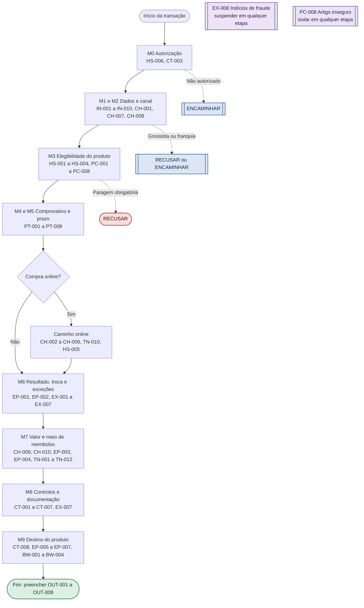
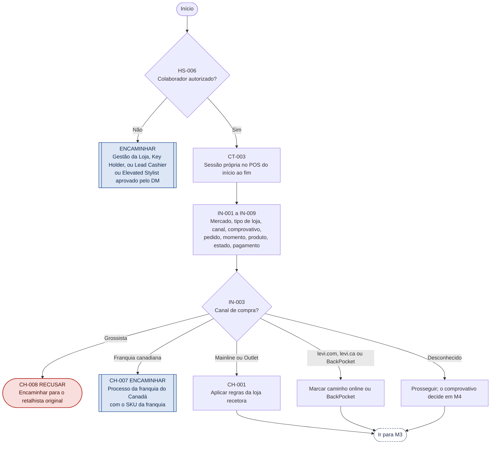
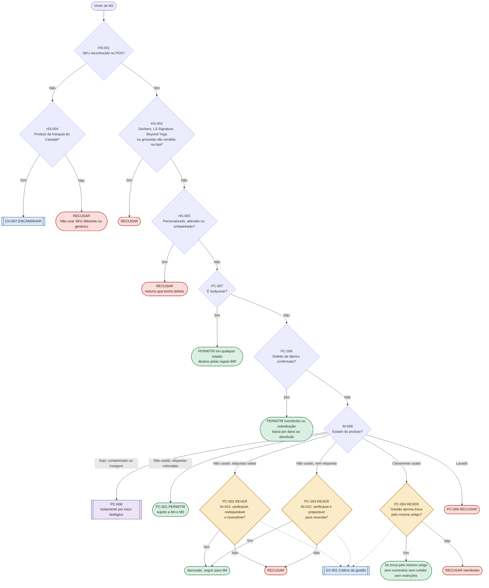
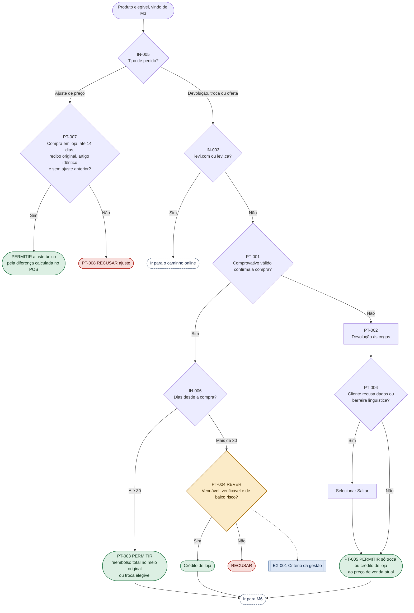
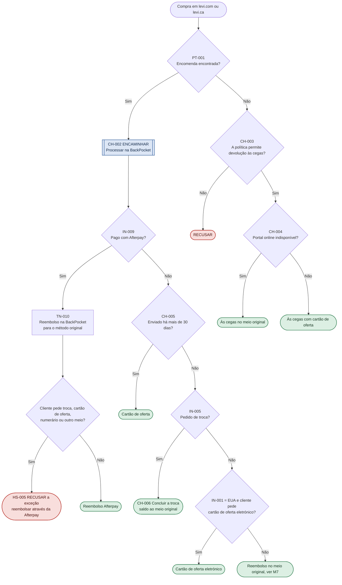
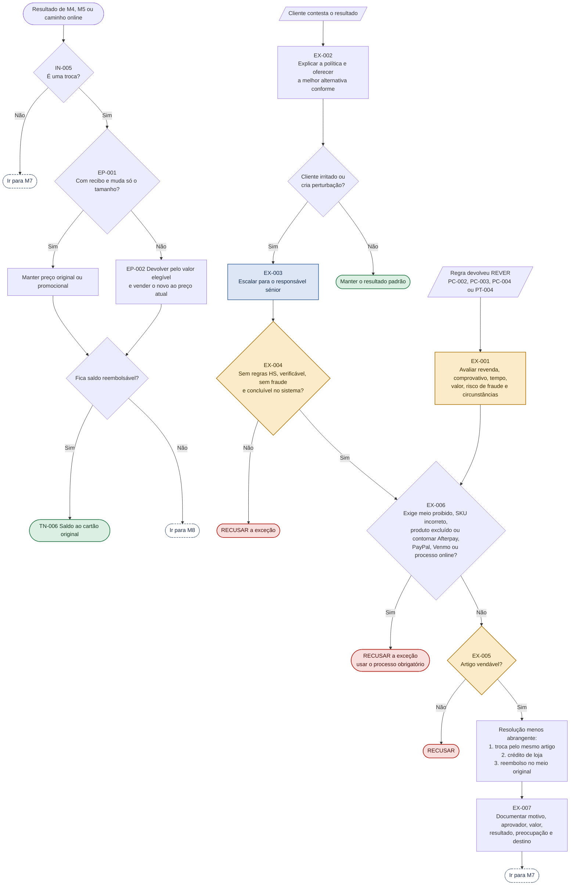
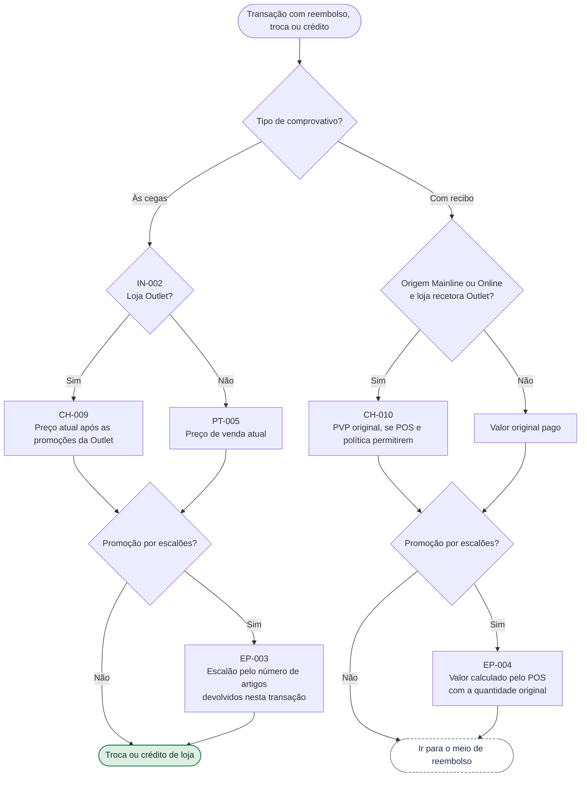
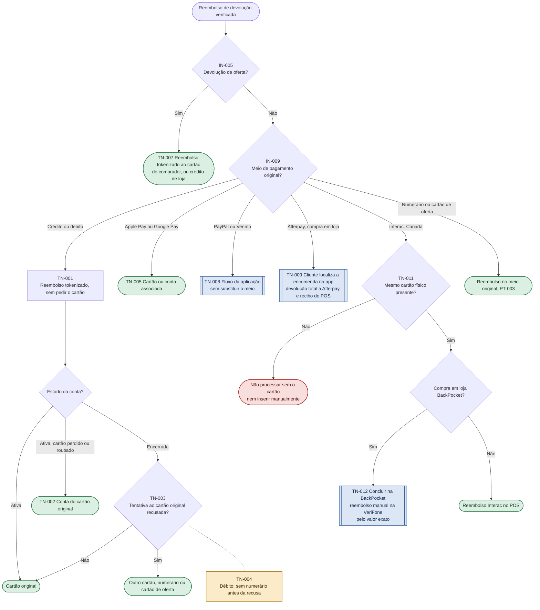
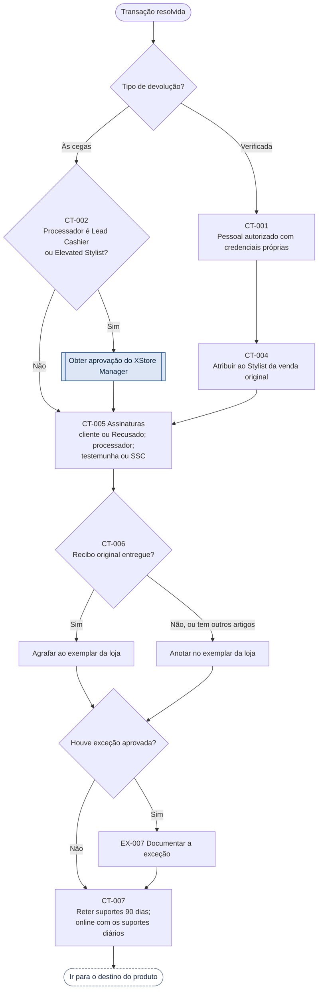
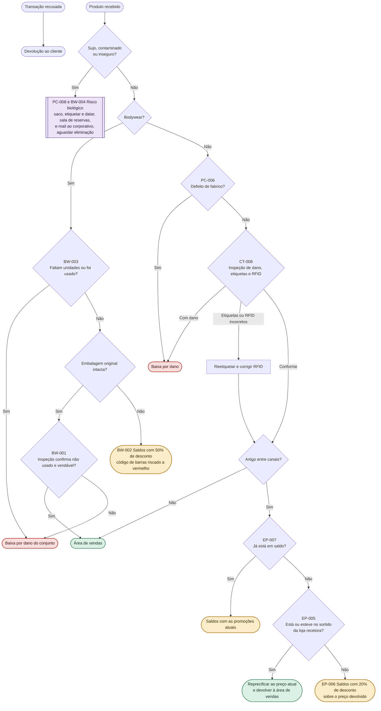

# 03 — Fluxograma de decisão

> Base de conhecimento procedimental do sistema pericial. Cada nó corresponde a uma regra de `01-base-conhecimento.md` / `02-regras-if-then.md`.
> Os diagramas estão em Mermaid (renderizam no VS Code com a extensão *Markdown Preview Mermaid Support* e no GitHub).

## Descrição

O fluxograma está organizado em dez módulos, que seguem a ordem de avaliação do motor de inferência:

1. Visão geral do processo completo.
2. Autorização, recolha de dados e canal (M0 a M2).
3. Elegibilidade do produto (M3).
4. Comprovativo e prazo (M4 e M5).
5. Caminho online, para levi.com e levi.ca.
6. Resultado da transação, trocas e exceções (M6).
7. Valor da devolução (M7).
8. Meio de reembolso (M7).
9. Controlos e documentação (M8).
10. Destino do produto (M9).

Cada nó tem o ID da regra de origem. As cores indicam o resultado e as formas distinguem decisões, ações, resultados terminais e subprocessos obrigatórios.

## Como ler

| Classe / cor | Significado |
|---|---|
| `permitir` (verde) | PERMITIR: processar segundo a regra padrão. |
| `recusar` (vermelho) | RECUSAR: não processar. |
| `rever` (âmbar) | REVER: critério ou aprovação da gestão. No destino do produto, indica venda com desconto. |
| `encaminhar` (azul) | ENCAMINHAR: processo obrigatório separado. |
| `transv` (violeta) | Transversal: segurança ou fraude; interrompe em qualquer etapa. |
| `ligacao` (tracejado) | Ligação: o fluxo continua noutro módulo. |

| Forma | Significado |
|---|---|
| Losango `{}` | Decisão: condição IF avaliada com os dados IN. |
| Retângulo `[]` | Ação intermédia do colaborador ou do POS. |
| Retângulo arredondado `([])` | Resultado terminal do ramo, que alimenta os campos OUT. |
| Retângulo duplo `[[]]` | Subprocesso obrigatório ou escalonamento. |
| Paralelogramo `[//]` | Evento de entrada que abre um fluxo paralelo. |

Setas tracejadas: regra acionada em paralelo, sem interromper o ramo principal.

## Pontos a validar com a operação

O documento de origem não cobre dois casos; estas lacunas foram preenchidas no fluxograma e **devem ser confirmadas antes de entrar em produção**:

- **Canal "desconhecido":** segue para a verificação do produto (M3) e é depois classificado pelo comprovativo (M4).
- **Compras pagas em numerário ou cartão de oferta:** são reembolsadas no meio original, segundo a regra PT-003.

## Módulos

### 1. Visão geral do processo

A ordem de avaliação dos oito módulos. Cada módulo só é executado se o anterior não terminou a transação. As duas regras transversais podem interromper o processo em qualquer ponto.

**Regras:** Todos os módulos; EX-008 e PC-008 como interrupções.

### 2. Autorização, dados e canal

Confirma quem pode processar, recolhe os dados de entrada e retira do fluxo os canais que a loja não trata.

**Regras:** HS-006, CT-003, IN-001 a IN-009, CH-001, CH-007, CH-008.

### 3. Elegibilidade do produto

Aplica primeiro as paragens obrigatórias e depois as regras de estado. O bodywear e o defeito de fabrico têm precedência sobre as regras de artigo usado ou lavado.

**Regras:** HS-001 a HS-004, PC-001 a PC-008, IN-010, EX-001.

### 4. Comprovativo e prazo

Separa os ajustes de preço, desvia as compras online para o seu caminho próprio e classifica as restantes como verificadas ou às cegas antes de aplicar o prazo.

**Regras:** PT-001 a PT-008, IN-004 a IN-006, EX-001.

### 5. Caminho online: levi.com e levi.ca

Trata as encomendas online devolvidas na loja. A Afterpay é avaliada primeiro porque proíbe qualquer meio alternativo.

**Regras:** CH-002 a CH-006, TN-010, HS-005, PT-001.

### 6. Resultado, troca e exceções

Define o preço nas trocas e conduz qualquer pedido de exceção até uma decisão documentada. Os controlos absolutos da regra EX-006 prevalecem sobre qualquer aprovação.

**Regras:** EP-001, EP-002, TN-006, EX-001 a EX-007.

### 7. Valor da devolução

Calcula o valor a devolver conforme o comprovativo, o tipo de loja e as promoções por escalões.

**Regras:** PT-003, PT-005, CH-009, CH-010, EP-003, EP-004.

### 8. Meio de reembolso

Escolhe o meio de reembolso de uma devolução verificada. O meio alternativo só é usado depois de o meio original falhar.

**Regras:** TN-001 a TN-009, TN-011, TN-012, PT-003.

### 9. Controlos e documentação

Garante a aprovação correta, as assinaturas, a atribuição da venda e a retenção dos suportes antes de fechar a transação.

**Regras:** CT-001 a CT-007, EX-007.

### 10. Destino do produto

Decide para onde vai cada artigo devolvido. A segurança é avaliada primeiro, depois o bodywear, depois a revenda.

**Regras:** PC-006, PC-008, CT-008, EP-005 a EP-007, BW-001 a BW-004.

## Notas de implementação

### Ordem de avaliação

O motor avalia os módulos por ordem, de M0 a M9. Dentro de cada módulo, as regras de paragem obrigatória são avaliadas antes das regras de estado, e as regras mais específicas antes das gerais: bodywear e defeito de fabrico antes de artigo usado ou lavado; Afterpay antes de qualquer outro meio online; EP-007 antes de EP-006.

### Interrupções transversais

EX-008 (fraude) e PC-008 (artigo inseguro) funcionam como eventos. Se dispararem, suspendem o ramo em curso: EX-008 bloqueia a transação até decisão da Gestão da Loja; PC-008 envia o artigo diretamente para isolamento, sem passar pela revenda.

### Precedências

- PC-007 anula PC-004 e PC-005 para bodywear.
- HS-003 anula PC-006 (produto alterado não é aceite mesmo com defeito).
- CH-004 substitui o meio predefinido de CH-003.
- TN-010 e HS-005 anulam CH-006 quando o pagamento foi com Afterpay.
- EX-006 anula qualquer aprovação dada por EX-004 ou EX-005.

### Campos de saída

| Campo | Preenchido por |
|---|---|
| OUT-001 Elegibilidade | Resultado terminal de M0 a M5 e do caminho online |
| OUT-002 Tipo de transação | M4, M5, caminho online e M6 |
| OUT-003 Valor da devolução | M7, valor da devolução |
| OUT-004 Meio de reembolso | M7, meio de reembolso, e caminho online |
| OUT-005 Aprovação | M3 (REVER), M6 (EX-001 a EX-005) e M8 (CT-002) |
| OUT-006 Processo obrigatório | Nós ENCAMINHAR de M0, M2, M3, caminho online e M7 |
| OUT-007 Destino do produto | Destino do produto (M9) |
| OUT-008 Documentação | M8 e EX-007 |
