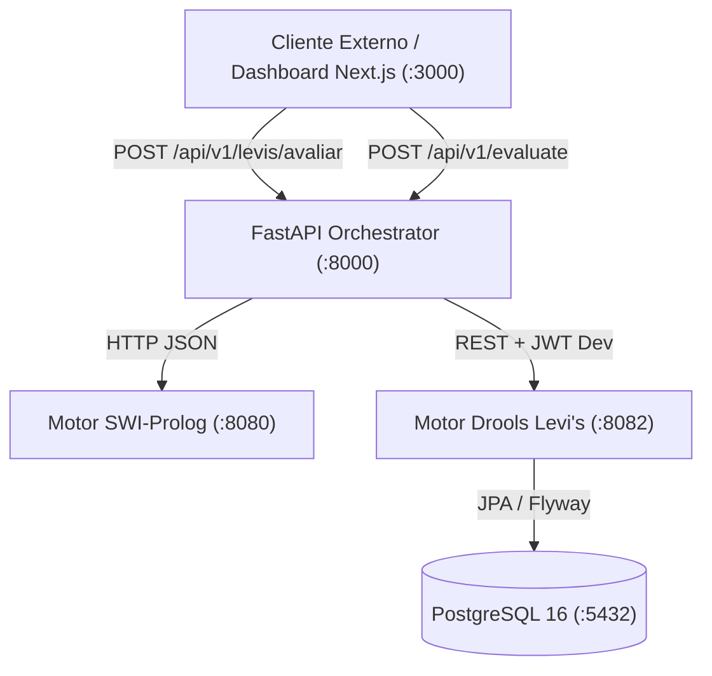

# API Pública v1 do Orquestrador (FastAPI)
### *Sistema Pericial de Diagnóstico para Devoluções e Trocas no Retalho*

---

## 1. Visão Geral

A camada de orquestração do sistema é exposta através de uma API REST desenvolvida em **FastAPI** (Python 3.11+). Esta API funciona como ponto de contacto único para clientes externos, dashboards web e interfaces de ponto de venda (*Frontends* e terminais POS), ocultando a complexidade dos motores de inferência subjacentes:
* **Motor SWI-Prolog (:8080):** Dedução lógica declarativa e inferência causal (*How / Why Not*).
* **Motor Drools Levi's (:8082):** Motor empresarial de regras de produção Rete-OO (Java 21 / Spring Boot 3 / Apache KIE Drools 8.44) com 98 regras DRL para triagem oficial de devoluções e trocas da marca Levi's, persistência em PostgreSQL e explicabilidade em 5 vias.



### 1.1 Configuração Base e URLs

| Ambiente | Host / Base URL | Descrição |
|:---|:---|:---|
| **Desenvolvimento Local (Host)** | `http://localhost:8000` | Acesso direto quando executado no host |
| **Produção / Domínio Público** | `https://challenge1.smbitsolutions.pt` | Instância pública com SSL/TLS |
| **Rede Docker Compose** | `http://orchestrator:8000` | Acesso inter-contentor dentro da rede `retail-network` |
| **Documentação Interativa (Swagger UI)** | `http://localhost:8000/docs` | Interface OpenAPI interativa sob as tags dedicadas |
| **Documentação Alternativa (ReDoc)** | `http://localhost:8000/redoc` | Interface de documentação técnica detalhada |
| **Especificação OpenAPI JSON** | `http://localhost:8000/openapi.json` | Schema JSON nativo OpenAPI 3.1 |

---

## 2. Endpoints de Diagnóstico e Monitorização

### 2.1 `GET /health` e `GET /api/v1/health`

Verifica a saúde operacional do serviço orquestrador e testa ativamente a conectividade com os motores de inferência.

* **Método HTTP:** `GET`
* **Caminho:** `/health` ou `/api/v1/health`
* **Autenticação:** Nenhuma
* **Resposta de Sucesso (`200 OK`):**
```json
{
  "status": "healthy",
  "prolog_engine": "connected",
  "timestamp": "2026-10-13T15:00:00.123456Z"
}
```

---

## 3. Endpoints do Motor Pericial de Devoluções Levi's (Drools)

Tag Swagger: **`Levi's Returns Expert Engine (Drools)`**  
Prefixo de Rota: **`/api/v1/levis`**

Estes endpoints expõem a base pericial de retalho da Levi's, integrando avaliação de cenários, motor de explicabilidade em 5 vias (*Como*, *Porquê*, *Porque Não*, *E Se*, *O Que Falta*), catálogo de regras e cenários de teste pré-formatados.

### 3.1 Resumo dos Endpoints da Levi's

| Método | Caminho | Resumo e Propósito |
|:---|:---|:---|
| `POST` | `/api/v1/levis/avaliar` | Submete um pedido de devolução/troca ao Drools e devolve o veredito completo. |
| `GET` | `/api/v1/levis/avaliacoes/{id}` | Recupera uma avaliação persistida por UUID no PostgreSQL. |
| `GET` | `/api/v1/levis/avaliacoes` | Lista o histórico de avaliações com suporte a paginação e ordenação. |
| `GET` | `/api/v1/levis/avaliacoes/{id}/explicacoes/como` | Explicação causal **Como?**: rasto ordenado das regras disparadas e módulos. |
| `GET` | `/api/v1/levis/avaliacoes/{id}/explicacoes/como/{codigo}` | Detalhes de disparo e fundamentação de uma regra específica. |
| `GET` | `/api/v1/levis/avaliacoes/{id}/explicacoes/porque-nao` | Análise contrafactual **Porque não?**: por que razão outros desfechos não foram atingidos. |
| `GET` | `/api/v1/levis/avaliacoes/{id}/explicacoes/porque-nao/{codigo}` | Análise contrafactual para um código de conclusão específico. |
| `GET` | `/api/v1/levis/avaliacoes/{id}/explicacoes/porque` | Explicação **Porquê?**: justifica as perguntas feitas ao operador de caixa. |
| `GET` | `/api/v1/levis/avaliacoes/{id}/explicacoes/o-que-falta` | Análise **O que falta?**: indica dados omissos para desbloquear aprovação. |
| `POST` | `/api/v1/levis/avaliacoes/{id}/simulacoes` | Simulador **E se?** (*What-If*): avalia variações hipotéticas sem alterar a base de dados. |
| `GET` | `/api/v1/levis/regras` | Lista o catálogo das 98 regras ativas na base de conhecimento. |
| `GET` | `/api/v1/levis/regras/{codigo}` | Detalhe exaustivo de uma regra DRL pelo seu código (ex.: `PT-003`). |
| `GET` | `/api/v1/levis/colaboradores` | Lista de colaboradores de loja pré-configurados para contexto operacional. |
| `GET` | `/api/v1/levis/cenarios-exemplo` | Lista os 10 cenários de teste oficiais da Levi's com payloads prontos. |
| `GET` | `/api/v1/levis/cenarios-exemplo/{numero}` | Devolve um cenário de teste específico (1 a 10) pelo número de índice. |

---

### 3.2 Avaliar Pedido (`POST /api/v1/levis/avaliar`)

Submete um pedido para inferência Drools. O endpoint aceita tanto o objeto `PedidoAvaliacaoRequest` direto como o objeto completo de um cenário de teste (`CenarioExemploResponse`), facilitando testes imediatos.

#### Exemplo de Pedido (`POST /api/v1/levis/avaliar`):
```json
{
  "tipoPedido": "DEVOLUCAO",
  "canal": "LOJA_FISICA",
  "tipoLoja": "MAINLINE",
  "dataPedido": "2026-10-13",
  "colaborador": {
    "id": "COLAB-001",
    "nome": "Dustin Hopper",
    "cargo": "COLABORADOR",
    "lojaId": "STORE-101"
  },
  "comprovativo": {
    "tipo": "RECIBO_ORIGINAL",
    "numeroRecibo": "REC-98213",
    "dataCompra": "2026-09-14",
    "valido": true
  },
  "artigos": [
    {
      "sku": "501-ORIGINAL-FIT-001",
      "categoria": "JEANS",
      "precoPago": 120.00,
      "precoAtual": 120.00,
      "estado": "NOVO",
      "etiqueta": "SOLTA",
      "personalizado": false,
      "pecaIntima": false
    }
  ],
  "pagamentos": [
    {
      "meio": "CARTAO_CREDITO",
      "valor": 120.00
    }
  ]
}
```

#### Exemplo de Resposta de Sucesso (`HTTP 200 OK`):
```json
{
  "id": "3fa85f64-5717-4562-b3fc-2c963f66afa6",
  "dataAvaliacao": "2026-10-13T15:20:00Z",
  "elegibilidade": "REVER",
  "motivoRecusa": null,
  "valorReembolso": 120.00,
  "meioLiquidacao": "VALE_COMPRAS",
  "requerAprovacaoGerente": true,
  "artigos": [
    {
      "sku": "501-ORIGINAL-FIT-001",
      "elegivel": true,
      "destino": "AREA_VENDA",
      "valorAprovado": 120.00,
      "justificacao": "Etiqueta solta requer verificação física e reaplicação antes de reposição."
    }
  ],
  "regrasAcionadas": [
    "M0-001 Autenticação do colaborador",
    "M2-001 Canal loja física validado",
    "M3-010 Etiqueta solta requer revisão gerencial",
    "M4-002 Comprovativo apresentado no 29º dia",
    "M7-005 Meio de liquidação ajustado para vale"
  ],
  "perguntasPendentes": []
}
```

#### Valores Possíveis para Campos Críticos:
* **`elegibilidade`:** `PERMITIR`, `RECUSAR`, `REVER`, `ENCAMINHAR`.
* **`meioLiquidacao`:** `ORIGINAL`, `VALE_COMPRAS`, `DINHEIRO`, `CARTAO_CREDITO`, `AFTERPAY`, `PAYPAL`, `SEM_REEMBOLSO`.
* **`destino` do artigo:** `AREA_VENDA`, `RISCO_BIOLOGICO`, `DEFEITO_FABRICO`, `DANIFICADO`, `ARMAZEM_CENTRAL`.

---

### 3.3 Explicabilidade: Como? (`GET /api/v1/levis/avaliacoes/{id}/explicacoes/como`)

Retorna a cadeia cronológica de deduções que fundamentaram o veredito.

#### Exemplo de Resposta (`HTTP 200 OK`):
```json
{
  "avaliacaoId": "3fa85f64-5717-4562-b3fc-2c963f66afa6",
  "totalRegrasDisparadas": 5,
  "passos": [
    {
      "ordem": 1,
      "regraId": "M0-001",
      "modulo": "M0-AUTORIZACAO",
      "descricao": "Colaborador autenticado com permissão de registo de devoluções.",
      "efeito": "Sessão validada"
    },
    {
      "ordem": 3,
      "regraId": "M3-010",
      "modulo": "M3-ELEGIBILIDADE",
      "descricao": "Artigo com etiquetas soltas exige inspeção do gerente de loja.",
      "efeito": "Decisão marcada como REVER"
    }
  ]
}
```

---

### 3.4 Explicabilidade: Porque Não? (`GET /api/v1/levis/avaliacoes/{id}/explicacoes/porque-nao`)

Explica por que razão conclusões mais favoráveis (como `PERMITIR` imediato ou `REEMBOLSO_DINHEIRO`) não foram atingidas, identificando os antecedentes que falharam:

#### Exemplo de Resposta (`HTTP 200 OK`):
```json
{
  "avaliacaoId": "3fa85f64-5717-4562-b3fc-2c963f66afa6",
  "conclusoesNaoAtingidas": [
    {
      "conclusaoAlvo": "PERMITIR",
      "regraCandidata": "PT-003",
      "descricao": "Devolução automática até 30 dias com etiquetas intactas",
      "condicoesFalhadas": [
        "Artigo.etiqueta == INTACTA (Valor atual: SOLTA)"
      ]
    }
  ]
}
```

---

### 3.5 Simulação Contrafactual *E Se?* (`POST /api/v1/levis/avaliacoes/{id}/simulacoes`)

Permite a um operador testar alterações pontuais sobre o pedido avaliado (por exemplo, assumir que a etiqueta foi encontrada intacta ou que o gerente autorizou a exceção) para verificar a decisão resultante **sem alterar a base de dados**.

#### Exemplo de Pedido (`POST /api/v1/levis/avaliacoes/{id}/simulacoes`):
```json
{
  "alteracoesArtigos": [
    {
      "sku": "501-ORIGINAL-FIT-001",
      "etiqueta": "INTACTA"
    }
  ]
}
```

#### Exemplo de Resposta (`HTTP 200 OK`):
```json
{
  "avaliacaoOriginalId": "3fa85f64-5717-4562-b3fc-2c963f66afa6",
  "elegibilidadeOriginal": "REVER",
  "elegibilidadeSimulada": "PERMITIR",
  "diferencas": [
    "A elegibilidade passou de REVER para PERMITIR.",
    "A aprovação gerencial deixou de ser necessária.",
    "O meio de liquidação mudou para CARTAO_CREDITO (meio original)."
  ]
}
```

---

### 3.6 Catálogo de Cenários de Teste (`GET /api/v1/levis/cenarios-exemplo`)

Devolve os 10 cenários de teste reais compilados a partir da base de conhecimento da Levi's, prontos para execução imediata no Dashboard ou via API:

1. **Cenário 1:** Troca ao 29.º dia com etiquetas soltas (`REVER`).
2. **Cenário 2:** Devolução com recibo e etiquetas intactas dentro de 30 dias (`PERMITIR`).
3. **Cenário 3:** Devolução fora do prazo de 30 dias com recibo (`REVER` / Vale de loja).
4. **Cenário 4:** Artigo personalizado embainhado (`RECUSAR`).
5. **Cenário 5:** Devolução sem comprovativo (*blind return*) dentro do limite (`REVER`).
6. **Cenário 6:** Artigo com defeito de fabrico comprovado (`PERMITIR` / Destino Defeito).
7. **Cenário 7:** Compra online devolvida em loja física Mainline (`PERMITIR`).
8. **Cenário 8:** Ajuste de preço no 10.º dia dentro do limite de 14 dias (`PERMITIR`).
9. **Cenário 9:** Bodywear / peça íntima sem embalagem selada (`RECUSAR` / Risco Biológico).
10. **Cenário 10:** Devolução paga por Afterpay com estorno digital (`PERMITIR`).

---

## 4. Endpoints do Motor SWI-Prolog (`/api/v1/evaluate` e `/api/v1/inference/*`)

### 4.1 `POST /api/v1/evaluate` (Motor de Retalho Declarativo)
Submete um cenário ao motor SWI-Prolog (`rules.pl`).

* **Payload Exemplo:** `{"scenario": "test", "value": 42}`
* **Resposta Exemplo (`200 OK`):**
```json
{
  "status": "success",
  "decision": "approved",
  "justification": [
    "Value matches the expected threshold of 42",
    "Item tags are marked as intact"
  ],
  "engine": "prolog",
  "timestamp": "2026-10-13T15:00:00Z"
}
```

---

## 5. Matriz Global de Códigos de Estado HTTP

| Código HTTP | Significado | Causa Principal | Formato da Resposta |
|:---|:---|:---|:---|
| **`200 OK`** | Sucesso | Avaliação processada com sucesso, consulta de histórico ou simulação concluída. | Schema tipado correspondente (`DecisaoResponse`, `SimulacaoResponse`, etc.) |
| **`400 Bad Request`** | Pedido Inválido | Violação semântica ou Bean Validation no motor Drools. | `{"detail": "..."}` |
| **`404 Not Found`** | Recurso Inexistente | UUID de avaliação inexistente ou código de regra não encontrado. | `{"detail": "Not Found"}` |
| **`422 Unprocessable Entity`** | Validação Falhou | Campos obrigatórios em falta no JSON (ex.: `tipoPedido` ou lista de `artigos` vazia). | Matriz de erros nativa Pydantic v2 |
| **`502 Bad Gateway`** | Falha de Terceiros | Erro interno ou exceção não tratada devolvida pelo Drools ou PostgreSQL. | `{"detail": "..."}` |
| **`503 Service Unavailable`** | Motor Inacessível | O orquestrador não conseguiu contactar o motor Drools ou SWI-Prolog (porta fechada ou timeout). | `{"detail": "Service Unavailable: ..."}` |

---

## 6. Documentos Relacionados

* [Catálogo de Schemas Pydantic](schemas.md) — Definição dos modelos `PedidoAvaliacaoRequest`, `DecisaoResponse`, etc.
* [Arquitetura do Motor Drools Levi's](../architecture/drools_engine.md) — Funcionamento dos 7 módulos e 98 regras.
* [Interações entre Serviços](../architecture/service_interactions.md) — Diagramas de sequência ponta-a-ponta e resolução de portas.
* [Histórico e Plano de Integração](../history/drools_levis_integration_plan.md) — Especificação original de todas as fases.
