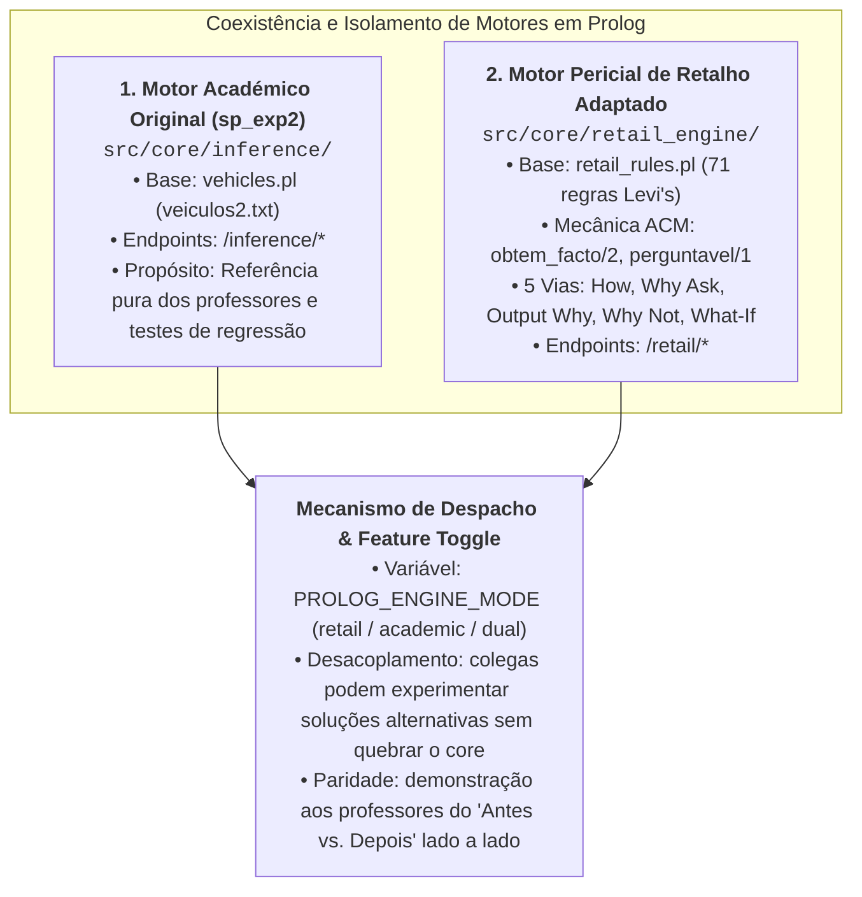
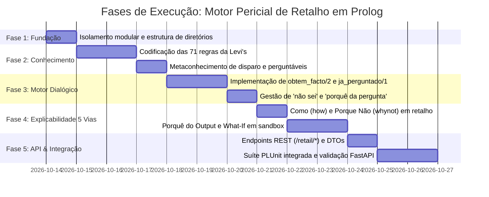

# Plano de Implementação: Motor Pericial de Retalho em Prolog
### *Adaptação Modular do sp_exp2 com Explicabilidade em 5 Vias e Isolamento por Paridade*
#### *MEIA 2026/2027 — Challenge 1 (Grupo 3: SmartCloth AI)*

---

## 1. Justificação Arquitetural da Estratégia de Isolamento e Paridade

A decisão de **isolar o motor pericial adaptado num novo diretório** (`prolog_engine/src/core/retail_engine/`) em vez de sobrescrever o motor de apoio original assenta em três princípios sólidos de engenharia de software e avaliação académica:



### Vantagens Estratégicas:
1. **Preservação da Linha de Base (*Baseline*):** O motor de veículos fornecido pelos professores ([`sp_exp2.pl`](../../prolog_engine/Ficheiros%20de%20Apoio%20Sistemas%20Periciais_%20sp_exp1.pl,%20sp_exp2.pl%20e%20base%20de%20conhecimento-20260928/sp_exp2.pl) / [`inference/engine.pl`](../../prolog_engine/src/core/inference/engine.pl)) permanece 100% funcional e compilável, com os seus testes unitários em [`tests/test_inference_engine.pl`](../../prolog_engine/tests/test_inference_engine.pl) a passar incondicionalmente.
2. **Defesa e Comparação Oral Perfeita:** Na apresentação de 50% de avaliação prática ([`Challenges4Teams-26-27.md`](../material_aulas/Challenges4Teams-26-27.md)), podes demonstrar ao docente: *“Aqui está o motor que nos deram a classificar camiões; e aqui está a evolução que desenhámos a resolver devoluções da Levi's com as suas perguntas e simulações contrafactuais”*.
3. **Colaboração em Equipa (*Pluggable Engines*):** Se outro elemento do Grupo 3 quiser testar um meta-intérprete alternativo (ex.: puramente orientado a *Backward-Chaining* ou com lógica difusa), o sistema suporta ligar e desligar módulos através de configuração sem conflitos no Git.

---

## 2. Mapa das Fontes da Verdade e Citações Oficiais

Todas as decisões técnicas deste plano derivam estritamente dos artefactos fornecidos:

| Documento de Referência | Âmbito | Citações e Requisitos Incorporados |
|:---|:---|:---|
| **[`MI_Perguntas_ACM.md`](../material_aulas/MI_Perguntas_ACM.md)** | Teoria PPROGIA (ACM) | • Substituição de `facto(N, X)` por `obtem_facto(X, N)` no `verifica_condicoes/2` (Secção 15).<br/>• Metaconhecimento de atributos perguntáveis `perguntavel/1` (Secção 9).<br/>• Tratamento defensivo de `nao_sei` com `ja_perguntado/1` (Secção 8 e 16).<br/>• Justificação bidirecional da pergunta ativa (*“Porquê?”*) (Secção 12). |
| **[`RPAC-Team3.md`](../material_aulas/RPAC-Team3.md)** | Relatório Oficial Grupo 3 | • 4 Desfechos Canónicos: `PERMITIR`, `RECUSAR`, `REVER`, `ENCAMINHAR` (Tabela 5).<br/>• Ordem estrita de prioridade entre regras (Precedência 1 a 7, Secção 4.6).<br/>• Entradas observáveis `IN-001` a `IN-010` (Tabela 6).<br/>• 10 Fluxogramas de decisão (Figuras 1 a 10). |
| **[`Returns & Exchanges Knowledge Base.md`](../material_aulas/Returns%20&%20Exchanges%20Knowledge%20Base.md)** | Fonte Normativa de Negócio | • As 71 regras de negócio distribuídas por 9 famílias (`HS`, `PC`, `PT`, `CH`, `TN`, `EP`, `EX`, `CT`, `BW`).<br/>• Critérios de exceção da gerência e tratamento de Afterpay e franquia canadiana. |
| **[`Challenges4Teams-26-27.md`](../material_aulas/Challenges4Teams-26-27.md)** | Critérios de Avaliação | • Demonstração prática do sistema pericial (50% do Challenge 1).<br/>• Explicabilidade e rastreabilidade total das deduções. |
| **[`sp_exp2_engine_analysis.md`](../architecture/sp_exp2_engine_analysis.md)** | Engenharia Interna | • Dissecação técnica dos 6 blocos do motor original e otimização por metaconhecimento `facto_dispara_regras/2`. |
| **[`prolog_expert_system_adaptation.md`](../architecture/prolog_expert_system_adaptation.md)** | Arquitetura Consolidada | • Arquitetura dual (Modo Batch REST vs. Modo Dialógico interativo) e 5 vias de explicabilidade. |

---

## 3. Estrutura de Diretórios Alvo

A arquitetura do micro-serviço SWI-Prolog ([`prolog_engine/`](../../prolog_engine)) evoluirá para a seguinte organização modular:

```text
prolog_engine/
├── src/
│   ├── api/
│   │   ├── server.pl                 # Gestão do daemon HTTP (thread_httpd)
│   │   ├── routes.pl                 # Endpoints legados (POC /evaluate)
│   │   ├── inference_routes.pl       # Endpoints do motor académico (/inference/*)
│   │   └── retail_routes.pl          # 🆕 Endpoints do motor pericial de retalho (/retail/*)
│   ├── core/
│   │   ├── rules.pl                  # Regras simples da POC inicial
│   │   ├── inference/                # 🔒 MOTOR ACADÉMICO DOS PROFESSORES (sp_exp2 preservado)
│   │   │   ├── engine.pl             # Motor sp_exp2 desacoplado de terminal
│   │   │   └── kb/
│   │   │       └── vehicles.pl       # Base de veículos (veiculos2.txt)
│   │   └── retail_engine/            # 🚀 NOVO: MOTOR PERICIAL DE RETALHO ADAPTADO
│   │       ├── engine.pl             # Motor evoluído (obtem_facto, 5 vias, what-if sandbox)
│   │       ├── interactive.pl        # Gestor de diálogo, perguntas dinâmicas e 'porquê?'
│   │       └── kb/
│   │           └── retail_rules.pl   # Base oficial de 71 regras Levi's + metaconhecimento
│   └── main.pl                       # Bootstrapping e registo condicional de módulos
└── tests/
    ├── test_inference_engine.pl      # Testes de regressão do motor académico (8 testes)
    ├── test_retail_rules.pl          # 🆕 Testes unitários das 71 regras de retalho
    ├── test_retail_interactive.pl    # 🆕 Testes do diálogo dinâmico e tratamento 'não sei'
    └── test_retail_explainability.pl # 🆕 Testes das 5 vias de explicabilidade
```

---

## 4. Fases de Execução do Plano

O desenvolvimento está estruturado em **cinco fases incrementais**, permitindo validação e testes automatizados no final de cada etapa:



---

### FASE 1: Isolamento Modular e Preservação de Paridade
* **Objetivo:** Estabelecer o novo diretório `retail_engine` sem interferir com `core/inference/`, assegurando que o motor original de veículos continua 100% operacional.
* **Tarefas Concretas:**
  1. Criar a estrutura `prolog_engine/src/core/retail_engine/` e `prolog_engine/src/core/retail_engine/kb/`.
  2. Criar o módulo base `retail_engine` herdando os operadores canónicos (`regra`, `se`, `entao`, `e`, `nao`).
  3. Atualizar `src/main.pl` para carregar ambos os módulos em namespaces isolados.
  4. Executar a suíte de testes de regressão [`test_inference_engine.pl`](../../prolog_engine/tests/test_inference_engine.pl) e comprovar que os 8 testes continuam a passar com 0 falhas.

---

### FASE 2: Modelação da Base de Conhecimento de Retalho (`retail_rules.pl`)
* **Objetivo:** Traduzir formalmente as **71 regras de negócio** e a ordem de prioridade de [`RPAC-Team3.md`](../material_aulas/RPAC-Team3.md) para a DSL do motor.
* **Tarefas Concretas:**
  1. **Codificar as 9 Famílias com Prefixos Oficiais:**
     * `HS-001` a `HS-006`: Paragens obrigatórias (credenciais do operador, SKU, marcas excluídas, personalização).
     * `PC-001` a `PC-008`: Condição física da peça (etiquetas, lavado, usado, defeito de fabrico, risco biológico e regime especial de *bodywear*).
     * `PT-001` a `PT-008`: Comprovativos e prazos (recibo fiscal, 30 dias, devolução às cegas, ajuste de preço até 14 dias).
     * `CH-001` a `CH-010`: Canais de venda (Mainline, Outlet, Online levi.com/ca, grossista, franquia canadiana).
     * `TN-001` a `TN-012`: Meios de reembolso (meio original, cartões, Afterpay, vales de compras).
     * `EP-001` a `EP-007`: Trocas e preservação de promoções de compra.
     * `EX-001` a `EX-008`: Regras de intervenção e exceção da gerência.
     * `CT-001` a `CT-008`: Auditoria, controlos de sessão e documentação.
     * `BW-001` a `BW-004`: Destino pós-devolução de vestuário íntimo.
  2. **Implementar a Ordem de Precedência (RPAC Secção 4.6):**
     * Garantir que `HS-006` avalia antes de qualquer outra regra;
     * Assegurar que regras de salubridade (`PC-008`) e paragens obrigatórias (`HS-001` a `HS-004`) sobrepõem-se a quaisquer exceções de gerência (`EX-001` a `EX-008`).
  3. **Mapear Metaconhecimento de Disparo:**
     * Definir `facto_dispara_regras/2` indexando os padrões dos factos de entrada `IN-001` a `IN-010` às regras candidatas correspondentes.
  4. **Declarar Atributos Perguntáveis:**
     * Mapear `perguntavel/1` para factos observáveis pelo colaborador de loja, proibindo expressamente a interrogação de conclusões diagnósticas.

---

### FASE 3: Motor Core Adaptado com a Mecânica de ACM
* **Objetivo:** Implementar o algoritmo proposto pelo Professor ACM em [`MI_Perguntas_ACM.md`](../material_aulas/MI_Perguntas_ACM.md), capacitando o motor para interrogar ativamente o operador perante dados omissos.
* **Tarefas Concretas:**
  1. **Predicado `obtem_facto/2`:**
     * Substituir a pesquisa estática `facto(N, X)` no `verifica_condicoes/2`.
     * Intercetar premissas ausentes: se `perguntavel(X)` e `\+ ja_perguntado(X)`, ativar a interface de interrogação.
  2. **Gestão de Sessão e Prevenção de Loops:**
     * Registar `assertz(ja_perguntado(X))` antes de submeter a questão para prevenir repetições indesejadas.
     * Tratar respostas `"não sei"` (*nao_sei*): registar a interrogação sem asserir o facto positivo, permitindo que a regra falhe graciosamente e o motor procure caminhos alternativos sem assumir falsidade lógica.
  3. **Rastreabilidade da Regra Ativa e Resposta "Porquê?":**
     * Armazenar contextualmente `regra_ativa(RegraID, Objetivo)` durante o ciclo `dispara_regras`.
     * Se o operador responder `"porquê?"`, recuperar os metadados da regra e exibir a justificação de negócio que fundamenta o pedido daquele atributo específico.
  4. **Origem do Facto:**
     * Ao receber uma resposta do operador, asserir `justifica(N, utilizador, [])` para rastreabilidade auditável na árvore causal.

---

### FASE 4: Módulo de Explicabilidade em 5 Vias
* **Objetivo:** Implementar as 5 perspetivas analíticas de diagnóstico pericial requeridas para nota máxima no Challenge 1.
* **Tarefas Concretas:**
  1. **Via 1: Como? (`como/1` — How):**
     * Adaptar o predicado para formatar a saída com os identificadores formais de regras (ex.: `[PC-001]`, `[PT-003]`) e discriminar claramente premissas fornecidas pelo operador versus premissas inferidas.
  2. **Via 2: Porquê da Pergunta? (*Why Ask*):**
     * Função dialógica de esclarecimento em tempo de recolha ativa de dados.
  3. **Via 3: Porquê da Decisão? (*Output Why*):**
     * Predicado de síntese que compila as conclusões terminais da avaliação num vetor legível `justification: list[str]` (desfecho `PERMITIR`, `RECUSAR`, `REVER` ou `ENCAMINHAR`).
  4. **Via 4: Porque Não? (`whynot/1` — Why Not):**
     * Adaptar `encontra_regras_whynot/2` para as regras de retalho.
     * Reportar exatamente que premissas falharam quando o operador questiona por que razão o pedido não foi aprovado com reembolso total (`PERMITIR`).
  5. **Via 5: E Se? (`what_if/3` — What-If Sandbox):**
     * Implementar o padrão de sandbox transitória usando `setup_call_cleanup/3`:
       ```prolog
       what_if(FactosAdicionar, FactosRemover, ComparacaoResultado)
       ```
     * Isolar o estado, correr a inferência hipotética, extrair o diferencial de desfecho e repor rigorosamente o estado original da memória dinâmica.

---

### FASE 5: Camada de Transporte REST, Toggle e Testes PLUnit
* **Objetivo:** Expor o motor adaptado via HTTP, criar testes automatizados completos e integrar com o ecossistema FastAPI.
* **Tarefas Concretas:**
  1. **Endpoints REST do Motor de Retalho (`src/api/retail_routes.pl`):**
     * `POST /retail/evaluate`: Avaliação batch canónica (recebe JSON completo e devolve `EvaluationResponse` com `justification[]`).
     * `POST /retail/interactive`: Inicia ou continua uma sessão de interrogação com recolha passo-a-passo.
     * `POST /retail/whatif`: Executa simulação contrafactual sem persistência.
     * `POST /retail/how`: Explica recursivamente um facto por ID.
     * `POST /retail/whynot`: Analisa porque é que um dado desfecho não foi atingido.
  2. **Feature Toggle no Orquestrador FastAPI:**
     * Adicionar configuração `PROLOG_ENGINE_MODE: Literal["retail", "academic", "dual"] = "retail"`.
     * Permitir chavear instantaneamente entre motores nas chamadas de avaliação.
  3. **Suíte de Testes Automatizados (PLUnit):**
     * `tests/test_retail_rules.pl`: 20 cenários cobrindo as 9 famílias (aprovação integral, defeito de fabrico, risco biológico, bodywear, devolução às cegas, Afterpay, marcas excluídas).
     * `tests/test_retail_explainability.pl`: Validação dos 5 modos de explicação.
     * `tests/test_retail_interactive.pl`: Validação da interrogação dinâmica e respostas "não sei" e "porquê?".

---

## 5. Critérios de Sucesso e Validação Final

O projeto cumpre com distinção todos os requisitos pedagógicos e práticos quando:
* [x] O motor académico original de veículos continua a passar nos 8 testes em `test_inference_engine.pl`;
* [x] A nova suíte de testes de retalho valida todas as 71 regras e as 7 prioridades sem ambiguidades lógicas;
* [x] O comando `como/1` detalha a cadeia dedutiva identificando a intervenção do operador e os IDs normativos;
* [x] O comando `whynot/1` identifica corretamente as premissas falhadas em pedidos recusados;
* [x] A interrogação dinâmica formula perguntas perante factos omissos e responde a *"porquê?"*;
* [x] O teste de simulação *What-If* calcula o impacto de hipóteses sem corromper o estado persistente da sessão;
* [x] Todos os contratos JSON cumprem as especificações canónicas de [`schemas.md`](../api/schemas.md).
