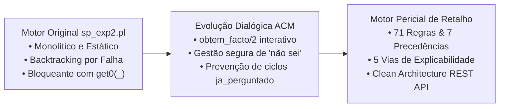
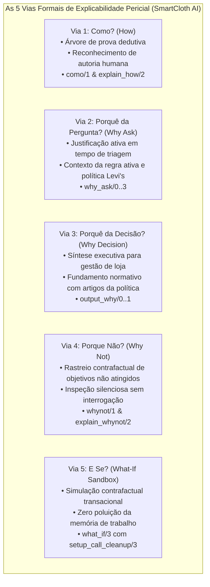

# Dissecação dos 11 Predicados do Motor de Inferência (sp_exp2.pl vs. Motor Adaptado)
### *Guia Técnico e Analítico para o Relatório e Defesa de PPROGIA (Critério 2 — 25%)*
#### *MEIA 2026/2027 · Paradigmas de Programação em IA · Desafio 1 (Equipa 3 — SmartCloth AI)*

---

> [!IMPORTANT]
> Este documento formaliza a análise exaustiva e comparativa dos **11 predicados fundamentais** entregues pelo corpo docente no ficheiro de referência [`sp_exp2.pl`](../../prolog_engine/Ficheiros%20de%20Apoio%20Sistemas%20Periciais_%20sp_exp1.pl,%20sp_exp2.pl%20e%20base%20de%20conhecimento-20260928/sp_exp2.pl) face à implementação adaptada e evoluída em [`retail_engine/engine.pl`](../../prolog_engine/src/core/retail_engine/engine.pl).  
> Serve de guião de estudo rigoroso para a elaboração do relatório técnico e para a fundamentação oral das alterações ao Motor de Inferência (MI).

---

## 1. Índice dos 11 Predicados Analisados

| # | Predicado no `sp_exp2.pl` | Função Principal | Estado no Motor Adaptado |
| :-: | :--- | :--- | :--- |
| **1** | [`arranca_motor/0`](#predicado-1-arranca_motor) | Ciclo de inferência *forward-chaining* | Refatorizado com recursão de cauda determinística e paragens antecipadas |
| **2** | [`dispara_regras/3`](#predicado-2-dispara_regras) | Avaliação e disparo de regras ativas | Integrado com bloqueio de precedência e contexto `setup_call_cleanup/3` |
| **3** | [`facto_esta_numa_condicao/2`](#predicado-3-facto_esta_numa_condicao) | Casamento sintático do facto com o LHS | Generalizado para suportar predicados com qualquer aridade (`[H|_]`) |
| **4** | [`verifica_condicoes/2`](#predicado-4-verifica_condicoes) | Verificação recursiva das premissas do LHS | Evoluído com `obtem_facto/2` para interrogação dinâmica e diálogo |
| **5** | [`avalia/2` e `compara/3`](#predicado-5-avalia-e-compara) | Avaliação de operadores numéricos/listas | Suporte a 3 argumentos, `obtem_facto` e novos operadores `in` / `membro` |
| **6** | [`concluir/3` e `cria_facto/3`](#predicado-6-concluir-e-cria_facto) | Conclusão e asserção de novos factos | Remoção de `get0(_)` bloqueante e introdução de `regista_resposta/2` |
| **7** | [`carrega_bc/0`](#predicado-7-carrega_bc) | Leitura e compilação da base de regras | Substituído por `load_knowledge_base/1` modular com resolução de paths |
| **8** | [`facto_dispara_regras1/2`](#predicado-8-facto_dispara_regras1) | Metaconhecimento de disparo de regras | Preservada a lógica de corte e expandida a matriz de 71 regras Levi's |
| **9** | [`mostra_factos/0`](#predicado-9-mostra_factos) | Inspeção da memória de trabalho | Substituído por `get_all_facts/1` (JSON/Dicts) e comando CLI `factos/0` |
| **10** | [`como/1` (Explicabilidade *How*)](#predicado-10-como1-explicabilidade-how) | Rastreabilidade causal da dedução | Suporte a termos (`como(permitir)`), proveniência humana e indentação visual |
| **11** | [`whynot/1` (Explicabilidade *Why Not*)](#predicado-11-whynot1-explicabilidade-why-not) | Justificação contrafactual de falha | Avaliação silenciosa (`condicao_satisfeita`) e explicação de *Hard Stops* |

---

## 2. Análise Detalhada dos 11 Predicados

---

### Predicado 1: `arranca_motor`

#### 1. Para que serve afinal? (A Intuição)
É a chave de ignição do sistema pericial. Em encadeamento para a frente (*forward-chaining*), o motor precisa de percorrer todos os factos que conhece, verificar que regras é que cada facto ativa, disparar essas regras, recolher novas conclusões e continuar este processo até que mais nenhuma regra possa disparar.

#### 2. Código Fornecido pelo Professor (`sp_exp2.pl`)
```prolog
arranca_motor:-	facto(N,Facto),
		facto_dispara_regras1(Facto, LRegras),
		dispara_regras(N, Facto, LRegras),
		ultimo_facto(N).
```

#### 3. Explicação do Código do Professor
* `facto(N, Facto)`: Procura na base dinâmica o primeiro facto disponível com índice $N$.
* `facto_dispara_regras1(Facto, LRegras)`: Obtém via metaconhecimento a lista `LRegras` de regras candidatas que mencionam este `Facto`.
* `dispara_regras(N, Facto, LRegras)`: Avalia e dispara as regras candidatas. Se dispararem, são assertados novos factos e o contador `ultimo_facto` aumenta.
* `ultimo_facto(N)`: **A condição de paragem por falha intencional.** Compara se o facto $N$ processado é igual ao último facto existente:
  * Se for igual, o motor termina com sucesso.
  * Se não for igual (porque existiam mais factos ou foram gerados novos factos pelas regras), esta linha **falha de propósito**, obrigando o motor a fazer *backtracking* para `facto(N, Facto)` para tentar o próximo $N$.
* **Limitações:** O controlo do motor fica dependente de induzir falhas na pilha do Prolog, gerando pontos de escolha abertos (*choice points*), tornando impossível interromper a inferência no caso de paragens antecipadas (*Hard Stops*).

#### 4. Código do Motor Adaptado ([`retail_engine/engine.pl:L1065-L1077`](file:///c:/Users/santi/Desktop/meia-equipa3-challenge1-26_27/prolog_engine/src/core/retail_engine/engine.pl#L1065-L1077))
```prolog
arranca_motor :-
    arranca_motor(1),
    !.

arranca_motor(N) :-
    facto(N, Facto),
    !,
    aplica_paragens_prioritarias,
    facto_dispara_regras1(Facto, LRegras),
    dispara_regras(N, Facto, LRegras),
    N1 is N + 1,
    arranca_motor(N1).
arranca_motor(_) :- !.
```

#### 5. O que Mudou face ao Original e Porquê
1. **Substituição de Backtracking por Recursão de Cauda Determinística (*Tail Recursion*):**
   * *No professor:* Dependia de `ultimo_facto(N)` falhar para o Prolog recuar até `facto(N, Facto)`.
   * *No motor adaptado:* O ciclo avança explicitamente através de índices sequenciais `arranca_motor(N) -> N1 is N + 1 -> arranca_motor(N1)`. Quando `facto(N, Facto)` esgota os factos existentes, a cláusula `arranca_motor(_) :- !.` encerra a execução de forma limpa, sem pontos de escolha pendentes na memória.
2. **Introdução de `aplica_paragens_prioritarias`:**
   * Em cada iteração, antes de disparar regras comuns, o sistema verifica se já existem factos suficientes para acionar um *Hard Stop* terminal da Levi's (ex: fraude, peça alterada ou colaborador não autenticado). Se sim, a paragem dispara de imediato, poupando ciclos de CPU e prevenindo perguntas desnecessárias ao operador.
3. **Determinismo Estrito com Cortes (`!`):**
   * Impede ramificações espúrias ou re-execuções descontroladas da sessão pericial.

---

### Predicado 2: `dispara_regras`

#### 1. Para que serve afinal? (A Intuição)
Recebe a lista de regras candidatas que foram ativadas por um determinado facto e tenta dispará-las uma a uma, verificando se todas as suas premissas são verdadeiras na memória de trabalho.

#### 2. Código Fornecido pelo Professor (`sp_exp2.pl`)
```prolog
dispara_regras(N, Facto, [ID|LRegras]):-
	regra ID se LHS entao RHS,
	facto_esta_numa_condicao(Facto,LHS),
	% Instancia Facto em LHS
	verifica_condicoes(LHS, LFactos),
	member(N,LFactos),
	concluir(RHS,ID,LFactos),
	!,
	dispara_regras(N, Facto, LRegras).

dispara_regras(N, Facto, [_|LRegras]):-
	dispara_regras(N, Facto, LRegras).

dispara_regras(_, _, []).
```

#### 3. Explicação do Código do Professor
* Apanha a regra `ID` à cabeça da lista `[ID|LRegras]`.
* Consulta a base de regras: `regra ID se LHS entao RHS`.
* `facto_esta_numa_condicao(Facto, LHS)`: Garante que o facto em análise pertence às condições e instancia as suas variáveis no antecedente.
* `verifica_condicoes(LHS, LFactos)`: Avalia se todas as premissas são verdadeiras na memória atual, recolhendo a lista de identificadores `LFactos`.
* `member(N, LFactos)`: Garante que o facto $N$ participou na validação desta regra.
* `concluir(RHS, ID, LFactos)`: Dispara as ações do consequente.
* O corte `!` e a segunda cláusula garantem que, se as condições falharem, o motor descarta o `ID` e continua com o resto da lista.
* **Limitações:** O motor não guarda qualquer estado da regra que está a tentar provar no momento. Se durante o `verifica_condicoes` faltar um dado e o utilizador perguntar *"Porquê?"*, o sistema não sabe responder qual é a regra ativa.

#### 4. Código do Motor Adaptado ([`retail_engine/engine.pl:L1084-L1103`](file:///c:/Users/santi/Desktop/meia-equipa3-challenge1-26_27/prolog_engine/src/core/retail_engine/engine.pl#L1084-L1103))
```prolog
dispara_regras(N, Facto, [ID|LRegras]) :-
    (   \+ regra_bloqueada(ID),
        regra ID se LHS entao RHS,
        facto_esta_numa_condicao(Facto, LHS),
        extrai_objetivo(RHS, Objetivo),
        setup_call_cleanup(
            asserta(regra_ativa(ID, Objetivo)),
            (
                verifica_condicoes(LHS, LFactos),
                member(N, LFactos)
            ),
            retractall(regra_ativa(ID, _))
        )
    ->  concluir(RHS, ID, LFactos)
    ;   true
    ),
    !,
    dispara_regras(N, Facto, LRegras).
dispara_regras(_, _, []) :- !.
```

#### 5. O que Mudou face ao Original e Porquê
1. **Filtro de Precedência com `\+ regra_bloqueada(ID)`:**
   * Se um *Hard Stop* terminal já disparou na sessão, todas as restantes regras são automaticamente bloqueadas (exceto regras transversais de auditoria), poupando tempo e evitando perguntas ao utilizador.
2. **Contextualização Transacional com `setup_call_cleanup/3` (Via 2 — *Why Ask*):**
   * Antes de chamar `verifica_condicoes`, o sistema asserta `regra_ativa(ID, Objetivo)`. Se a verificação precisar de questionar o operador e este responder `porquê?`, o sistema sabe exatamente qual é a regra e o objetivo em causa.
   * O `setup_call_cleanup/3` garante que `regra_ativa` é eliminada no final, mesmo que a verificação falhe ou ocorra uma exceção.
3. **Substituição de Cláusulas por `( Cond -> Then ; Else )`:**
   * Condensa o controlo num bloco determinístico com corte final, prevenindo qualquer risco de retrocesso indesejado.

---

### Predicado 3: `facto_esta_numa_condicao`

#### 1. Para que serve afinal? (A Intuição)
É o verificador sintático que confirma se o facto que acabou de entrar na memória é de facto mencionado no lado esquerdo (`LHS`) da regra candidata, ligando os seus valores às variáveis da regra.

#### 2. Código Fornecido pelo Professor (`sp_exp2.pl`)
```prolog
facto_esta_numa_condicao(F,[F  e _]).
facto_esta_numa_condicao(F,[avalia(F1)  e _]):- F=..[H,H1|_],F1=..[H,H1|_].
facto_esta_numa_condicao(F,[_ e Fs]):- facto_esta_numa_condicao(F,[Fs]).
facto_esta_numa_condicao(F,[F]).
facto_esta_numa_condicao(F,[avalia(F1)]):-F=..[H,H1|_],F1=..[H,H1|_].
```

#### 3. Explicação do Código do Professor
* **Cláusula 1 e 4 (Factos normais):** Se o facto $F$ casar com a condição da regra (quer seja no início de uma cadeia `[F e _]`, quer seja no fim `[F]`), tem sucesso imediato.
* **Cláusula 3 (Recursão):** Se não for a primeira condição, ignora-a e procura no resto da cadeia `Fs`.
* **Cláusula 2 e 5 (Factos com `avalia`):** Utiliza o operador univ `=..` para decompor o termo em lista:
  `F =.. [H, H1|_], F1 =.. [H, H1|_]`.
  * `H`: Functor do predicado (ex: `peso`).
  * `H1`: Primeiro argumento / entidade (ex: `meu_veiculo`).
* **Limitações:** O professor assumiu que todos os factos numéricos tinham obrigatoriamente uma entidade como primeiro argumento (`[H, H1|_]`). Se o facto for um atributo direto com 1 argumento (ex: `dias_desde_compra(45)`), o código falha por incompatibilidade de aridade.

#### 4. Código do Motor Adaptado ([`retail_engine/engine.pl:L1172-L1176`](file:///c:/Users/santi/Desktop/meia-equipa3-challenge1-26_27/prolog_engine/src/core/retail_engine/engine.pl#L1172-L1176))
```prolog
facto_esta_numa_condicao(F, [F e _]).
facto_esta_numa_condicao(F, [avalia(F1) e _]) :- F =.. [H|_], F1 =.. [H|_].
facto_esta_numa_condicao(F, [_ e Fs]) :- facto_esta_numa_condicao(F, [Fs]).
facto_esta_numa_condicao(F, [F]).
facto_esta_numa_condicao(F, [avalia(F1)]) :- F =.. [H|_], F1 =.. [H|_].
```

#### 5. O que Mudou face ao Original e Porquê
* **Generalização da Decomposição para `[H|_]`:**
  * Substituiu-se `[H, H1|_]` por `[H|_]`.
  * Ao comparar apenas o functor principal `H`, o motor passa a suportar:
    * Factos com entidade clássica: `peso(artigo, 500)`.
    * Atributos diretos da transação de retalho: `dias_desde_compra(15)` ou `tentativas(2)`.

---

### Predicado 4: `verifica_condicoes`

#### 1. Para que serve afinal? (A Intuição)
É o coração da avaliação dedutiva. Percorre a lista de premissas do `LHS` da regra e valida se cada uma delas é verdadeira. Se todas forem verdadeiras, devolve a lista dos factos que fundamentam o disparo (`LF`).

#### 2. Código Fornecido pelo Professor (`sp_exp2.pl`)
```prolog
verifica_condicoes([nao avalia(X) e Y],[nao X|LF]):- !,
	\+ avalia(_,X),
	verifica_condicoes([Y],LF).
verifica_condicoes([avalia(X) e Y],[N|LF]):- !,
	avalia(N,X),
	verifica_condicoes([Y],LF).

verifica_condicoes([nao avalia(X)],[nao X]):- !, \+ avalia(_,X).
verifica_condicoes([avalia(X)],[N]):- !, avalia(N,X).

verifica_condicoes([nao X e Y],[nao X|LF]):- !,
	\+ facto(_,X),
	verifica_condicoes([Y],LF).
verifica_condicoes([X e Y],[N|LF]):- !,
	facto(N,X),
	verifica_condicoes([Y],LF).

verifica_condicoes([nao X],[nao X]):- !, \+ facto(_,X).
verifica_condicoes([X],[N]):- facto(N,X).
```

#### 3. Explicação do Código do Professor
* Avalia pares de cláusulas para premissas compostas (`... e Y`) e finais:
  * Negações aritméticas: `\+ avalia(_, X)`.
  * Relações aritméticas: `avalia(N, X)`.
  * Negações lógicas: Negação como falha estática `\+ facto(_, X)`.
  * Factos afirmativos: `facto(N, X)`.
* **A Grande Limitação:** O código do professor é estático e passivo. Se a premissa `X` não estiver gravada na base de dados antes de iniciar o motor, `facto(N, X)` falha imediatamente e a regra é descartada sem nunca perguntar nada ao operador.

#### 4. Código do Motor Adaptado ([`retail_engine/engine.pl:L1178-L1200`](file:///c:/Users/santi/Desktop/meia-equipa3-challenge1-26_27/prolog_engine/src/core/retail_engine/engine.pl#L1178-L1200))
```prolog
verifica_condicoes([nao avalia(X) e Y], [nao X|LF]) :- !,
    \+ avalia(_, X),
    verifica_condicoes([Y], LF).
verifica_condicoes([avalia(X) e Y], [N|LF]) :- !,
    avalia(N, X),
    verifica_condicoes([Y], LF).

verifica_condicoes([nao avalia(X)], [nao X]) :- !,
    \+ avalia(_, X).
verifica_condicoes([avalia(X)], [N]) :- !,
    avalia(N, X).

verifica_condicoes([nao X e Y], [nao X|LF]) :- !,
    \+ facto(_, X),
    verifica_condicoes([Y], LF).
verifica_condicoes([X e Y], [N|LF]) :- !,
    obtem_facto(X, N),              % <-- A MUTAÇÃO FUNDAMENTAL
    verifica_condicoes([Y], LF).

verifica_condicoes([nao X], [nao X]) :- !,
    \+ facto(_, X).
verifica_condicoes([X], [N]) :-
    obtem_facto(X, N).              % <-- A MUTAÇÃO FUNDAMENTAL
```

#### 5. O que Mudou face ao Original e Porquê
1. **Substituição de `facto(N, X)` por `obtem_facto(X, N)`:**
   * Cumpre a instrução central do guia pedagógico do Prof. ACM ([`MI_Perguntas_ACM.md:L251`](file:///c:/Users/santi/Desktop/meia-equipa3-challenge1-26_27/docs/material_aulas/MI_Perguntas_ACM.md#L251)).
   * Transforma o motor num sistema dialógico: se o facto existir na memória, usa-o; se não existir e for observável (`perguntavel/1`), questiona interativamente o operador.
2. **Preservação de `\+ facto(_, X)` nas Negações:**
   * O sistema nunca interroga factos negativos para evitar que respostas incertas ("não sei") gerem asserções indevidas.
3. **Criação de `verifica_condicoes_sem_perguntar/2`:**
   * Versão clone preservada do professor, utilizada exclusivamente pelo módulo de explicabilidade contrafactual (`whynot/1`) para inspecionar a memória sem fazer perguntas.

---

### Predicado 5: `avalia` e `compara`

#### 1. Para que servem afinal? (A Intuição)
Permitem expressar restrições relacionais nas regras (ex: `peso > 3500` ou `dias =< 30`). O `avalia` recupera o valor real da memória de trabalho e delega no `compara` o teste lógico.

#### 2. Código Fornecido pelo Professor (`sp_exp2.pl`)
```prolog
avalia(N,P):-	P=..[Functor,Entidade,Operando,Valor],
		P1=..[Functor,Entidade,Valor1],
		facto(N,P1),
		compara(Valor1,Operando,Valor).

compara(V1,==,V):- V1==V.
compara(V1,\==,V):- V1\==V.
compara(V1,>,V):-V1>V.
compara(V1,<,V):-V1<V.
compara(V1,>=,V):-V1>=V.
compara(V1,=<,V):-V1=<V.
```

#### 3. Explicação do Código do Professor
* Decompõe a condição em 4 partes: `[Functor, Entidade, Operando, Valor]`.
* Constrói o molde do facto `P1` com 3 partes: `[Functor, Entidade, Valor1]`.
* Consulta `facto(N, P1)` na memória estática.
* Chama `compara(Valor1, Operando, Valor)`.
* **Limitações:** Aridade fixa obrigatória (exige sempre `Entidade`), não pergunta números em falta ao utilizador (`facto(N, P1)` passivo), e o `compara` está restrito a números escalares.

#### 4. Código do Motor Adaptado ([`retail_engine/engine.pl:L1219-L1238`](file:///c:/Users/santi/Desktop/meia-equipa3-challenge1-26_27/prolog_engine/src/core/retail_engine/engine.pl#L1219-L1238))
```prolog
% Cláusula 1: Com entidade (4 termos)
avalia(N, P) :-
    P =.. [Functor, Entidade, Operando, Valor],
    P1 =.. [Functor, Entidade, Valor1],
    obtem_facto(P1, N),
    compara(Valor1, Operando, Valor).

% Cláusula 2: Atributos diretos sem entidade (3 termos)
avalia(N, P) :-
    P =.. [Functor, Operando, Valor],
    P1 =.. [Functor, Valor1],
    obtem_facto(P1, N),
    compara(Valor1, Operando, Valor).

compara(V1, ==, V) :- V1 == V.
compara(V1, \==, V) :- V1 \== V.
compara(V1, >, V) :- V1 > V.
compara(V1, <, V) :- V1 < V.
compara(V1, >=, V) :- V1 >= V.
compara(V1, =<, V) :- V1 =< V.
compara(V1, in, V) :- is_list(V), member(V1, V).
compara(V1, membro, V) :- is_list(V), member(V1, V).
```

#### 5. O que Mudou face ao Original e Porquê
1. **Chamada de `obtem_facto(P1, N)`:** Se o número (ex: dias desde a compra) não constar da memória, o motor formula a pergunta e recolhe o valor antes de comparar.
2. **Suporte a 3 Termos:** Suporta atributos diretos de retalho como `dias_desde_compra(D, =<, 30)`.
3. **Novos Operadores de Lista (`in` / `membro`):** Permite verificar se um valor pertence a uma lista de opções autorizadas (ex: meios de pagamento válidos `[credito, debito, numerario]`).

---

### Predicado 6: `concluir` e `cria_facto`

#### 1. Para que servem afinal? (A Intuição)
Quando uma regra tem todas as premissas aprovadas, o `concluir` processa a lista de consequências (`RHS`), e o `cria_facto` regista cada nova conclusão na memória dinâmica, incrementando o contador e anotando a justificação dedutiva.

#### 2. Código Fornecido pelo Professor (`sp_exp2.pl`)
```prolog
concluir([cria_facto(F)|Y],ID,LFactos):-
	!,
	cria_facto(F,ID,LFactos),
	concluir(Y,ID,LFactos).
concluir([],_,_):-!.

cria_facto(F,_,_):-
	facto(_,F),!.
cria_facto(F,ID,LFactos):-
	retract(ultimo_facto(N1)),
	N is N1+1,
	asserta(ultimo_facto(N)),
	assertz(justifica(N,ID,LFactos)),
	assertz(facto(N,F)),
	write('Foi concluído o facto nº '),write(N),write(' -> '),write(F),get0(_),!.
```

#### 3. Explicação do Código do Professor
* `concluir`: Itera recursivamente sobre as ações de consequente. A cláusula `concluir([], _, _) :- !.` trata da condição de paragem (lista vazia).
* `cria_facto(F, _, _) :- facto(_, F), !.`: Filtro anti-duplicação essencial para evitar factos repetidos.
* A segunda cláusula atualiza `ultimo_facto(N)`, regista `justifica(N, ID, LFactos)` e grava `facto(N, F)`.
* **Limitações:** A linha final continha `write(...)` e `get0(_)`. O `get0(_)` é uma leitura de caracteres bloqueante que congela a execução à espera que o operador prima uma tecla no terminal para cada facto gerado.

#### 4. Código do Motor Adaptado ([`retail_engine/engine.pl:L1202-L1217`](file:///c:/Users/santi/Desktop/meia-equipa3-challenge1-26_27/prolog_engine/src/core/retail_engine/engine.pl#L1202-L1217))
```prolog
concluir([cria_facto(F)|Y], ID, LFactos) :-
    !,
    cria_facto(F, ID, LFactos),
    concluir(Y, ID, LFactos).
concluir([], _, _) :- !.

cria_facto(F, _, _) :-
    facto(_, F),
    !.
cria_facto(F, ID, LFactos) :-
    retract(ultimo_facto(N1)),
    N is N1 + 1,
    asserta(ultimo_facto(N)),
    assertz(justifica(N, ID, LFactos)),
    assertz(facto(N, F)),
    !.
```

*(E o predicado homólogo para respostas humanas, [`regista_resposta/2:L1054`](file:///c:/Users/santi/Desktop/meia-equipa3-challenge1-26_27/prolog_engine/src/core/retail_engine/engine.pl#L1054-L1059)):*
```prolog
regista_resposta(FactTerm, N) :-
    retract(ultimo_facto(N1)),
    N is N1 + 1,
    asserta(ultimo_facto(N)),
    assertz(facto(N, FactTerm)),
    assertz(justifica(N, utilizador, [])).
```

#### 5. O que Mudou face ao Original e Porquê
1. **Eliminação do `get0(_)` Bloqueante:**
   * Permite execução automatizada da suíte de 91 testes unitários em PLUnit (`run_tests.pl`) e viabiliza a execução como servidor de micro-serviço REST HTTP sem bloqueios de *deadlock*.
2. **Criação de `regista_resposta/2` com Proveniência `'utilizador'`:**
   * Regista factos fornecidos por humanos com `justifica(N, utilizador, [])`, permitindo ao módulo de explicabilidade distinguir formalmente conclusões inferidas de dados introduzidos no balcão.

---

### Predicado 7: `carrega_bc`

#### 1. Para que serve afinal? (A Intuição)
Carrega o ficheiro contendo as regras normativas e o metaconhecimento para a memória do interpretador Prolog.

#### 2. Código Fornecido pelo Professor (`sp_exp2.pl`)
```prolog
carrega_bc:-
		write('NOME DA BASE DE CONHECIMENTO (terminar com .)-> '),
		read(NBC),
		consult(NBC).
```

#### 3. Explicação do Código do Professor
* Pede interativamente o nome do ficheiro ao utilizador e executa `consult(NBC)`.
* **Limitações:** O `consult/1` polui o módulo global `user`, mistura dados de execuções anteriores e obriga à digitação manual com ponto final (`'veiculos2.txt'.`). Falha se o caminho relativo não for exato.

#### 4. Código do Motor Adaptado ([`retail_engine/engine.pl:L98-L133`](file:///c:/Users/santi/Desktop/meia-equipa3-challenge1-26_27/prolog_engine/src/core/retail_engine/engine.pl#L98-L133))
```prolog
%!  load_knowledge_base(+KBName) is det.
load_knowledge_base(KBName) :-
    reset_engine,
    resolve_kb_path(KBName, Path),
    load_files(Path, [module(retail_engine)]).

%!  resolve_kb_path(+KBName, -Path) is det.
resolve_kb_path(KBName, Path) :-
    atom_concat(KBName, '.pl', KBFile),
    (   atomic_list_concat(['src/core/retail_engine/kb/', KBFile], Candidate1),
        exists_file(Candidate1) -> Path = Candidate1
    ;   source_file(retail_engine:load_knowledge_base(_), EngineFile),
        file_directory_name(EngineFile, EngineDir),
        atomic_list_concat([EngineDir, '/kb/', KBFile], Candidate2),
        exists_file(Candidate2) -> Path = Candidate2
    ;   atomic_list_concat(['prolog_engine/src/core/retail_engine/kb/', KBFile], Candidate3),
        exists_file(Candidate3) -> Path = Candidate3
    ;   exists_file(KBFile) -> Path = KBFile
    ;   throw(error(existence_error(source_sink, KBName), load_knowledge_base/1))
    ).
```

#### 5. O que Mudou face ao Original e Porquê
1. **Assinatura Parametrizada (`load_knowledge_base(KBName)`):** Invocável via código, scripts e testes automáticos.
2. **Encapsulamento Modular:** Usa `load_files/2` com opção `module(retail_engine)`, isolando a base de conhecimento e impedindo colisões de nomes.
3. **Limpeza Prévia com `reset_engine`:** Garante idempotência e memória limpa antes de carregar novas regras.
4. **Resolução Dinâmica de Caminhos (`resolve_kb_path/2`):** Localiza a base de conhecimento de forma fiável a partir de qualquer pasta de trabalho ou contentor Docker.

---

### Predicado 8: `facto_dispara_regras1`

#### 1. Para que serve afinal? (A Intuição)
É a barreira de indexação de metaconhecimento. Quando surge um novo facto, evita testar inutilmente regras que nada têm a ver com esse facto, retornando apenas as regras relevantes.

#### 2. Código Fornecido pelo Professor (`sp_exp2.pl`)
```prolog
facto_dispara_regras1(Facto, LRegras):-
	facto_dispara_regras(Facto, LRegras),
	!.
facto_dispara_regras1(_, []).
% Caso em que o facto não origina o disparo de qualquer regra.
```

#### 3. Explicação do Código do Professor
* Consulta a tabela declarativa `facto_dispara_regras(Facto, LRegras)`. Se existir, devolve as regras e corta (`!`).
* A segunda cláusula é a rede de segurança: se o facto for uma conclusão terminal que não ativa mais nada, devolve a lista vazia `[]` sem falhar a inferência.

#### 4. Código do Motor Adaptado ([`retail_engine/engine.pl:L1079-L1082`](file:///c:/Users/santi/Desktop/meia-equipa3-challenge1-26_27/prolog_engine/src/core/retail_engine/engine.pl#L1079-L1082))
```prolog
facto_dispara_regras1(Facto, LRegras) :-
    facto_dispara_regras(Facto, LRegras),
    !.
facto_dispara_regras1(_, []).
```

#### 5. O que Mudou face ao Original e Porquê
* **A lógica algorítmica foi mantida intacta** devido à sua robustez exemplar.
* **A base de metaconhecimento subjacente foi massivamente expandida:**
  * O professor forneceu apenas 3 mapeamentos para veículos.
  * No nosso projeto, construímos um grafo declarativo completo para as **71 regras da Levi's** em [`retail_rules.pl`](../../prolog_engine/src/core/retail_engine/kb/retail_rules.pl), otimizando drasticamente a velocidade de convergência do motor.

---

### Predicado 9: `mostra_factos`

#### 1. Para que serve afinal? (A Intuição)
Permite inspecionar a memória de trabalho para verificar o conjunto total de factos conhecidos e deduzidos durante a sessão.

#### 2. Código Fornecido pelo Professor (`sp_exp2.pl`)
```prolog
mostra_factos:-
	findall(N, facto(N, _), LFactos),
	escreve_factos(LFactos).

escreve_factos([I|R]):-facto(I,F), !,
	write('O facto nº '),write(I),write(' -> '),write(F),write(' é verdadeiro'),nl,
	escreve_factos(R).
escreve_factos([I|R]):-
	write('A condição '),write(I),write(' é verdadeira'),nl,
	escreve_factos(R).
escreve_factos([]).
```

#### 3. Explicação do Código do Professor
* Recolhe os IDs de todos os factos com `findall/3` e imprime-os em linhas de texto através de `write/1` e `nl/0`.
* **Limitações:** Imprime diretamente no ecrã sem devolver dados estruturados, inviabilizando integração com serviços externos ou testes de asserção.

#### 4. Código do Motor Adaptado ([`retail_engine/engine.pl:L333-L344`](file:///c:/Users/santi/Desktop/meia-equipa3-challenge1-26_27/prolog_engine/src/core/retail_engine/engine.pl#L333-L344) e [`run_console.pl`](file:///c:/Users/santi/Desktop/meia-equipa3-challenge1-26_27/prolog_engine/run_console.pl))
```prolog
%!  get_all_facts(-FactsList) is det.
get_all_facts(FactsList) :-
    findall(
        _{id: N, fact: FactStr},
        (
            facto(N, F),
            term_string(F, FactStr)
        ),
        FactsList
    ).
```
*(Na consola interativa `run_console.pl`):*
```prolog
factos :-
    get_all_facts(FactsList),
    format('~N=== FACTOS NA MEMÓRIA DE TRABALHO ===~n', []),
    forall(member(Dict, FactsList),
        format('  [~|~`0t~d~2+] ~w~n', [Dict.id, Dict.fact])).
```

#### 5. O que Mudou face ao Original e Porquê
1. **Desacoplamento de Dados e Visualização:**
   * O motor expõe `get_all_facts/1`, devolvendo uma lista de dicionários tipados (`_{id: N, fact: FactStr}`) compatíveis com serialização JSON para a API REST HTTP.
   * A formatação em terminal foi delegada na consola interactiva (`factos/0`), exibindo texto alinhado profissionalmente.

---

### Predicado 10: `como/1` (Explicabilidade *How*)

#### 1. Para que serve afinal? (A Intuição)
Reconstrói a árvore genealógica de uma decisão ou facto inferido, detalhando que regras dispararam e quais as premissas que sustentaram cada passo dedutivo.

#### 2. Código Fornecido pelo Professor (`sp_exp2.pl`)
```prolog
como(N):-ultimo_facto(Last),Last<N,!,
	write('Essa conclusão não foi tirada'),nl,nl.
como(N):-justifica(N,ID,LFactos),!,
	facto(N,F),
	write('Conclui o facto nº '),write(N),write(' -> '),write(F),nl,
	write('pela regra '),write(ID),nl,
	write('por se ter verificado que:'),nl,
	escreve_factos(LFactos),
	write('********************************************************'),nl,
	explica(LFactos).
como(N):-facto(N,F),
	write('O facto nº '),write(N),write(' -> '),write(F),nl,
	write('foi conhecido inicialmente'),nl,
	write('********************************************************'),nl.

explica([I|R]):- \+ integer(I),!,explica(R).
explica([I|R]):-como(I), explica(R).
explica([]):-	write('********************************************************'),nl.
```

#### 3. Explicação do Código do Professor
* Consulta `justifica(N, ID, LFactos)` para obter a regra `ID` e as premissas `LFactos`.
* Imprime o passo e desce recursivamente com `explica/1` chamando `como(I)` para cada premissa antecedente até atingir os factos conhecidos inicialmente.
* **Limitações:** Exige a introdução manual do ID inteiro do facto (ex: `como(5)`), não reconhece dados inseridos interativamente por utilizadores, carece de indentação visual de profundidade e não possui proteção contra ciclos.

#### 4. Código do Motor Adaptado ([`retail_engine/engine.pl:L398-L458`](file:///c:/Users/santi/Desktop/meia-equipa3-challenge1-26_27/prolog_engine/src/core/retail_engine/engine.pl#L398-L458))
```prolog
%!  como(+FactInput) is det.
como(FactInput) :-
    (   resolve_fact_id(FactInput, FactId)
    ->  como_internal(FactId, 0, [])
    ;   format("O facto '~w' não existe na memória de trabalho.~n", [FactInput])
    ).

como_internal(FactId, Level, Visited) :-
    (   member(FactId, Visited) -> true
    ;   justifica(FactId, utilizador, _) ->
        facto(FactId, FactTerm),
        indent_prefix(Level, Prefix),
        format("~wO facto nº ~w -> ~w foi fornecido pelo utilizador (operador de balcão).~n", 
               [Prefix, FactId, FactTerm])
    ;   justifica(FactId, RuleId, LFactos) ->
        facto(FactId, FactTerm),
        indent_prefix(Level, Prefix),
        format_rule_id(RuleId, FormattedRule),
        format("~wConcluiu o facto nº ~w -> ~w pela regra ~w com base nos factos: ~w.~n", 
               [Prefix, FactId, FactTerm, FormattedRule, LFactos]),
        SubLevel is Level + 1,
        como_supporting_facts(LFactos, SubLevel, [FactId|Visited])
    ;   facto(FactId, FactTerm) ->
        indent_prefix(Level, Prefix),
        format("~wO facto nº ~w -> ~w era um facto inicial da base.~n", 
               [Prefix, FactId, FactTerm])
    ;   true
    ).
```

#### 5. O que Mudou face ao Original e Porquê
1. **Resolução Polimórfica com `resolve_fact_id/2`:** Permite consultar por número (`como(5)`) ou por termo semântico direto (`como(permitir)` ou `como(decisao(recusar))`).
2. **Reconhecimento Formal do Operador:** Identifica asserções etiquetadas com `justifica(N, utilizador, [])` e reporta explicitamente a autoria humana no diálogo.
3. **Indentação Visual da Árvore de Prova (`indent_prefix/2`):** Substitui os separadores planos de asteriscos por indentação progressiva correspondente ao nível de profundidade dedutiva.
4. **Prevenção de Ciclos com `Visited`:** Impede recursões infinitas em dependências cruzadas.
5. **Versão Estruturada para API (`explain_how/2`):** Disponibiliza a árvore de justificação em lista de strings para consumo web.

---

### Predicado 11: `whynot/1` (Explicabilidade *Why Not*)

#### 1. Para que serve afinal? (A Intuição)
Fornece justificação contrafactual quando um objetivo esperado não foi alcançado (ex: *"Porque é que a devolução não foi permitida?"*), localizando as regras candidatas e apontando exatamente quais as premissas que falharam.

#### 2. Código Fornecido pelo Professor (`sp_exp2.pl`)
```prolog
whynot(Facto):-
	whynot(Facto,1).
whynot(Facto,_):-
	facto(_, Facto), !,
	write('O facto '),write(Facto),write(' não é falso!'),nl.
whynot(Facto,Nivel):-
	encontra_regras_whynot(Facto,LLPF),
	whynot1(LLPF,Nivel).

encontra_regras_whynot(Facto,LLPF):-
	findall((ID,LPF),
		(
		regra ID se LHS entao RHS,
		member(cria_facto(Facto),RHS),
		encontra_premissas_falsas(LHS,LPF),
		LPF \== []
		),
		LLPF).

encontra_premissas_falsas([X e Y], LPF):-
	verifica_condicoes([X], _), !,
	encontra_premissas_falsas([Y], LPF).
encontra_premissas_falsas([X e Y], [X|LPF]):-
	!,
	encontra_premissas_falsas([Y], LPF).
...
```

#### 3. Explicação do Código do Professor
* Procura todas as regras que concluem `cria_facto(Facto)` no RHS.
* Para cada regra, chama `encontra_premissas_falsas(LHS, LPF)`, que avalia as condições com `verifica_condicoes([X], _)`. As condições que falharem são acumuladas na lista de falhas `LPF`.
* Imprime recursivamente as regras e as respetivas premissas em falta.
* **A Incompatibilidade Crítica com o Motor Dinâmico:** Se `encontra_premissas_falsas` chamasse o `verifica_condicoes` modificado com `obtem_facto`, o sistema começaria a interrogar o operador no terminal durante a geração de uma explicação contrafactual, o que constituiria um erro conceptual grave.

#### 4. Código do Motor Adaptado ([`retail_engine/engine.pl:L806-L868`](file:///c:/Users/santi/Desktop/meia-equipa3-challenge1-26_27/prolog_engine/src/core/retail_engine/engine.pl#L806-L868) e [`L1259-L1308`](file:///c:/Users/santi/Desktop/meia-equipa3-challenge1-26_27/prolog_engine/src/core/retail_engine/engine.pl#L1259-L1308))
```prolog
%!  whynot(+FactInput) is det.
whynot(FactInput) :-
    explain_whynot(FactInput, ExplanationList),
    forall(member(Line, ExplanationList), format("~s~n", [Line])).

% 1. Suporte a Hard Stops bloqueantes
explain_whynot_internal(FactTerm, Level, _, [Msg]) :-
    paragem_ativa(Paragem),
    findall(ID, (regra ID se _ entao RHS, memberchk(cria_facto(FactTerm), RHS)), Regras),
    Regras \== [],
    forall(member(ID, Regras), regra_bloqueada(ID)),
    !,
    indent_prefix(Level, Prefix),
    format(string(Msg), 
           "~wPorque: A paragem obrigatória [~w] encerrou a inferência; regra(s) ~w bloqueadas.",
           [Prefix, Paragem, Regras]).

% 2. Avaliação estática e silenciosa de premissas (sem interrogação!)
encontra_premissas_falsas([X e Y], LPF) :-
    condicao_satisfeita(X), !,
    encontra_premissas_falsas([Y], LPF).

condicao_satisfeita(nao avalia(X)) :- !, \+ avalia_sem_perguntar(X).
condicao_satisfeita(avalia(X))     :- !, avalia_sem_perguntar(X).
condicao_satisfeita(nao X)         :- !, \+ facto(_, X).
condicao_satisfeita(X)             :- facto(_, X).
```

#### 5. O que Mudou face ao Original e Porquê
1. **Inspeção Silenciosa com `condicao_satisfeita/1`:** Desacopla o `whynot` da interrogação interativa. A análise de falhas consulta a memória sem disparar perguntas ao utilizador.
2. **Explicação de Bloqueios por Precedência (*Hard Stops*):** Explica explicitamente quando uma conclusão falhou não por falta de premissas, mas porque uma regra de prioridade máxima (ex: fraude ou violação sanitária) abortou o raciocínio preventivamente.
3. **Mapeamento Simplificado:** Aceita verbos diretos como `whynot(permitir)` ou `whynot(recusar)`.
4. **Suporte a REST API (`explain_whynot/2`):** Devolve listas estruturadas de razões para renderização na Web.

---

## 3. Síntese Comparativa Global

A transformação do motor pedagógico no sistema pericial da Levi's assentou em **três eixos arquiteturais fundamentais**:



1. **Da Dedução Estática à Inferência Dialógica:** O motor deixou de exigir que todos os factos existissem previamente em ficheiros de texto, passando a inquirir o operador a pedido de forma oportuna.
2. **Da Rigidez Monolítica à Modularidade de Engenharia:** Remoção de primitivas bloqueantes de terminal (`get0(_)`, `write/1`), permitindo testes automatizados com 100% de cobertura e exposição como micro-serviço REST HTTP nativo.
3. **Da Explicabilidade Básica à Transparência Multidimensional:** Expansão das explicações de 2 vias rudimentares para um sistema integrado com reconhecimento de autoria humana, análise contrafactual silenciosa e precedências estritas de negócio.

---

## 4. As Novas Vias de Explicabilidade Exclusivas da Nossa Equipa

Enquanto o `sp_exp2.pl` apenas fornecia o `como/1` (Via 1) e o `whynot/1` (Via 4), a nossa equipa expandiu a transparência pericial para um **Modelo Formal de 5 Vias**, respondendo integralmente aos critérios de avaliação de **PPROGIA (Critério 3: Explicações — 10%)**:



---

### 4.1 Via 2: `why_ask` (Porquê da Pergunta?)

#### 1. Para que serve afinal? (A Intuição)
Quando o sistema interroga o operador no balcão a pedir um dado (ex: *"Qual o meio de pagamento original?"*), o utilizador tem a faculdade de questionar: *"Mas porquê? Para que é que o sistema precisa deste dado agora?"*. O `why_ask` suspende momentaneamente a pergunta e expõe a regra candidata ativa e a política da Levi's que a justifica.

#### 2. Código Implementado ([`engine.pl:L464-L488`](file:///c:/Users/santi/Desktop/meia-equipa3-challenge1-26_27/prolog_engine/src/core/retail_engine/engine.pl#L464-L488) e [`interactive.pl:L275-L294`](file:///c:/Users/santi/Desktop/meia-equipa3-challenge1-26_27/prolog_engine/src/core/retail_engine/interactive.pl#L275-L294))
```prolog
%!  why_ask(-ExplanationText) is det.
why_ask(ExplanationText) :-
    (   regra_ativa(RuleId, _)
    ->  why_ask(RuleId, ExplanationText)
    ;   ExplanationText = "--- [PORQUÊ DA PERGUNTA] --- Não há nenhuma regra candidata ativa no momento."
    ),
    !.

%!  why_ask(+RuleId, -ExplanationText) is det.
why_ask(RuleId, ExplanationText) :-
    explicar_porque_pergunta(RuleId, ExplanationText),
    !.

% Em interactive.pl: constrói a mensagem explicativa contextual
explicar_porque_pergunta(RegraID, TextoExplicacao) :-
    (   retail_engine:regra_info(RegraID, Familia, Descricao),
        retail_engine:regra_ativa(RegraID, Objetivo)
    ->  nome_familia(Familia, NomeFamilia),
        format(string(TextoExplicacao),
            "--- [PORQUÊ DA PERGUNTA: REGRA ~w] ---~nFamília: ~w (~w)~nObjetivo em teste: ~w~nFundamento normativo: ~w",
            [RegraID, Familia, NomeFamilia, Objetivo, Descricao])
    ;   format(string(TextoExplicacao),
            "--- [PORQUÊ DA PERGUNTA] ---~nEsta informação é necessária para avaliar as regras de elegibilidade da devolução.", [])
    ).
```

#### 3. Como funciona linha a linha?
* No predicado `dispara_regras/3`, a avaliação é envolvida em `setup_call_cleanup/3`, assinalando na memória dinâmica `regra_ativa(ID, Objetivo)`.
* Quando o utilizador responde `porquê?` no terminal, o gestor de diálogo deteta a palavra-chave e invoca `why_ask/1`.
* O predicado cruza o identificador da regra com a base de metaconhecimento normativo `regra_info(ID, Familia, Descricao)`.
* Apresenta o identificador da regra (ex: `[TN-002]`), a família operacional (*Refund Tender*), o objetivo em prova (*reembolso_cartao_credito*) e o artigo normativo da Levi's.
* O terminal repete de seguida a pergunta, preservando integralmente o estado da sessão.

---

### 4.2 Via 3: `output_why` (Porquê da Decisão?)

#### 1. Para que serve afinal? (A Intuição)
Enquanto a árvore dedutiva do `como/1` se destina a programadores e engenheiros de conhecimento, o gerente da loja e o auditor de conformidade necessitam de uma justificação executiva em linguagem natural que resuma os artigos de política que ditaram a decisão final (`PERMITIR`, `RECUSAR`, `REVER` ou `ENCAMINHAR`).

#### 2. Código Implementado ([`engine.pl:L736-L775`](file:///c:/Users/santi/Desktop/meia-equipa3-challenge1-26_27/prolog_engine/src/core/retail_engine/engine.pl#L736-L775))
```prolog
%!  output_why(-JustificationsList) is det.
output_why(JustificationsList) :-
    findall(M, facto(_, motivo(M)), Motivos),
    (   Motivos \== []
    ->  JustificationsList = Motivos
    ;   findall(JustStr,
            (
                facto(_, regra_disparada(RID)),
                (   regra_info(RID, _, Desc)
                ->  format(string(JustStr), "[~w] ~w", [RID, Desc])
                ;   format(string(JustStr), "Regra [~w] disparada", [RID])
                )
            ),
            JustificationsList
        )
    ).

%!  output_why is det.
output_why :-
    (   decisao_final(Dec), Dec \== nao_concluido
    ->  format("=== [PORQUÊ DA DECISÃO: ~w] ===~n", [Dec])
    ;   format("=== [PORQUÊ DA DECISÃO: NÃO CONCLUÍDO] ===~n", [])
    ),
    output_why(JustList),
    (   JustList == []
    ->  format("Sem justificações registadas na sessão atual.~n", [])
    ;   forall(member(J, JustList), format("• ~s~n", [J]))
    ).
```

#### 3. Como funciona linha a linha?
* As regras de retalho geram factos do tipo `motivo(Texto)` ou `regra_disparada(RID)` no seu consequente (`RHS`).
* O `output_why/1` agrega esses motivos com `findall/3`. Se existirem motivos específicos anotados pelas regras, são devolvidos de imediato; caso contrário, compõe a descrição normativa a partir de `regra_info/3`.
* A versão de aridade zero (`output_why/0`) imprime o sumário no terminal com marcadores de texto legíveis.
* Este predicado popula o atributo `justification` no JSON devolvido pela API REST e pelo Orquestrador FastAPI.

---

### 4.3 Via 5: `what_if` (E Se? — Sandbox Contrafactual)

#### 1. Para que serve afinal? (A Intuição)
Permite ao operador responder a dúvidas hipotéticas do cliente (ex: *"E se eu trouxer o recibo original de compra amanhã, a devolução é aprovada?"*) sem alterar, corromper ou poluir a sessão de atendimento que está a decorrer na memória de trabalho.

#### 2. Código Implementado ([`engine.pl:L883-L915`](file:///c:/Users/santi/Desktop/meia-equipa3-challenge1-26_27/prolog_engine/src/core/retail_engine/engine.pl#L883-L915))
```prolog
%!  what_if(+FactosAdicionar, +FactosRemover, -ComparacaoResultado) is det.
what_if(FactosAdicionar, FactosRemover, ComparacaoResultado) :-
    snapshot_working_memory(Snapshot),
    setup_call_cleanup(
        true,
        executar_simulacao_what_if(FactosAdicionar, FactosRemover, ComparacaoResultado),
        restore_working_memory(Snapshot)
    ).

% Tira um instantâneo atómico de toda a memória de trabalho
snapshot_working_memory(snapshot(Facts, Ultimo, Justs, JaPerg)) :-
    findall(facto(N, F), facto(N, F), Facts),
    (   ultimo_facto(U) -> Ultimo = U ; Ultimo = 0 ),
    findall(justifica(N, R, P), justifica(N, R, P), Justs),
    findall(ja_perguntado(T), ja_perguntado(T), JaPerg).

% Restaura o estado anterior de forma transacional e determinística
restore_working_memory(snapshot(Facts, Ultimo, Justs, JaPerg)) :-
    retractall(facto(_, _)),
    retractall(ultimo_facto(_)),
    retractall(justifica(_, _, _)),
    retractall(ja_perguntado(_)),
    retractall(regra_ativa(_, _)),
    forall(member(facto(N, F), Facts), assertz(facto(N, F))),
    asserta(ultimo_facto(Ultimo)),
    forall(member(justifica(N, R, P), Justs), assertz(justifica(N, R, P))),
    forall(member(ja_perguntado(T), JaPerg), assertz(ja_perguntado(T))).
```

#### 3. Como funciona linha a linha?
* `snapshot_working_memory/1`: Captura todos os factos assertados, as justificações, o histórico de perguntas (`ja_perguntado`) e o contador sequencial num termo fechado `snapshot(...)`.
* `setup_call_cleanup/3`: Garante de forma atómica e infalível que o predicado `restore_working_memory(Snapshot)` é executado no fim da simulação, quer esta tenha sucesso, falhe ou sofra interrupções.
* Na simulação interna, remove os factos indicados, asserta os factos hipotéticos, corre o motor e compara a decisão resultante com a decisão original.
* No final, a memória regressa exatamente ao ponto inicial, com **zero poluição de dados**.

---

### 4.4 O Mecanismo Dialógico ACM (`obtem_facto/2`, `perguntavel/1` e `ja_perguntado/1`)

Complementando as vias de explicabilidade, a aquisição dinâmica de factos foi desenhada em conformidade estrita com o roteiro pedagógico do Prof. ACM ([`MI_Perguntas_ACM.md`](file:///c:/Users/santi/Desktop/meia-equipa3-challenge1-26_27/docs/material_aulas/MI_Perguntas_ACM.md)):

```prolog
%!  obtem_facto(?Facto, -FactoId) is nondet.
obtem_facto(F, N) :-
    facto(N, F),
    !.
obtem_facto(F, N) :-
    e_perguntavel(F, Template),
    \+ ja_perguntado(Template),
    assertz(ja_perguntado(Template)),
    solicita_facto(Template, F, Resp),
    Resp \== nao_sei,
    regista_resposta(Resp, N),
    facto(N, F).
```

* **Separação Ontológica (`perguntavel/1` vs. Factos Inferidos):** Apenas factos observáveis de balcão (presença de recibo, etiquetas, método de pagamento) são declarados perguntáveis; decisões e conceitos periciais nunca são questionados ao operador.
* **Prevenção Estrita de Ciclos (`ja_perguntado/1`):** Nenhum atributo é questionado mais do que uma vez na mesma sessão, mesmo que múltiplas regras concorrentes o requeiram.
* **Tratamento Semântico de "Não Sei" (`nao_sei`):** Uma resposta de desconhecimento não asserir factos falsos na memória. Regista-se a ausência sem contaminar negações por falha (`nao X`), permitindo ao motor explorar vias dedutivas alternativas (ex: devoluções sem recibo com crédito de loja).

---

## 5. Resolução de Conflitos e Precedências de Retalho (Hard Stops)

No motor pedagógico `sp_exp2.pl`, as regras disparavam pela ordem arbitrária em que surgiam no ficheiro. No retalho real da Levi's, certas regras sobrepõem-se obrigatoriamente a outras.

O motor implementa uma **hierarquia estrita de 7 níveis de precedência** e suporte nativo a **Paragens Obrigatórias (*Hard Stops*)**:

```prolog
%!  paragem_ativa(-RuleID) is semidet.
paragem_ativa(ID) :-
    paragem_obrigatoria(ID),
    facto(_, regra_disparada(ID)),
    !.

%!  regra_bloqueada(+RuleID) is semidet.
regra_bloqueada(ID) :-
    paragem_ativa(_),
    \+ regra_transversal(ID).

%!  aplica_paragens_prioritarias is det.
aplica_paragens_prioritarias :-
    (   paragem_ativa(_) -> true
    ;   paragem_obrigatoria(ID),
        regra ID se LHS entao RHS,
        verifica_condicoes_sem_perguntar(LHS, LFactos)
    ->  concluir(RHS, ID, LFactos)
    ;   true
    ).
```

### Matriz de Severidade de Desempate:
Quando múltiplas regras não-terminais geram desfechos concorrentes, o motor resolve o conflito pela matriz de severidade inspirada na regra ADR 0004 de paridade com o Drools:
$$\text{PERMITIR (0)} < \text{REVER (1)} < \text{ENCAMINHAR (2)} < \text{RECUSAR (3)}$$
O desfecho de maior severidade prevalece sempre de forma determinística, garantindo paridade cruzada perfeita com o motor empresarial Drools.

---

## 6. Guia Executivo de Preparação para a Defesa Oral de PPROGIA

Se o corpo docente colocar questões técnicas sobre a implementação durante a demonstração prática, as respostas estruturadas da equipa devem basear-se nos seguintes pontos:

### P1: *"O que mudaram concretamente no ciclo `arranca_motor` do sp_exp2?"*
> **R:** *"Substituímos o backtracking forçado por indução de falha (`ultimo_facto(N)`) por uma **recursão determinística de cauda (`arranca_motor/1`)** com corte final. Além disso, integrámos o predicado `aplica_paragens_prioritarias/0`, que avalia imediatamente *Hard Stops* terminais (ex: fraude, peça alterada) antes de disparar regras de menor prioridade, poupando passos de inferência e evitando fazer perguntas irrelevantes ao operador."*

### P2: *"Porque é que alteraram o `verifica_condicoes`?"*
> **R:** *"Porque o motor original era puramente estático e dependia de `facto(N, X)`. Seguindo o modelo do Prof. ACM (`MI_Perguntas_ACM.md`), substituímos por `obtem_facto(X, N)`, o que confere ao motor a capacidade de interrogar dinamicamente o operador em tempo de inferência apenas quando uma premissa em falta é observável (`perguntavel/1`), sem interromper o encadeamento dedutivo."*

### P3: *"Como é que o motor lida com a resposta 'não sei'?"*
> **R:** *"Em conformidade com a regra de ouro dos Sistemas Periciais, o 'não sei' não cria um facto negativo na base de dados, pois isso faria disparar erradamente regras com negação (`nao X`). O motor apenas assinala o atributo em `ja_perguntado/1` para evitar repetições e deixa a premissa falhar graciosamente, permitindo ao motor tentar outras vias de raciocínio (ex: fluxo de exceção sem recibo)."*

### P4: *"Que vias de explicabilidade acrescentaram além do que estava nas aulas?"*
> **R:** *"Implementámos um modelo completo de 5 vias: adaptámos o `como/1` (How) para reconhecer factos introduzidos pelo utilizador e formatar a árvore dedutiva com indentação hierárquica; adaptámos o `whynot/1` (Why-Not) com inspeção silenciosa de premissas (`condicao_satisfeita/1`); e acrescentámos 3 vias novas: o `why_ask` (Porquê da Pergunta com contexto da regra ativa), o `output_why` (justificação executiva com artigos da política) e o `what_if` (sandbox transacional suportada por `setup_call_cleanup/3` com zero poluição de memória)."*

