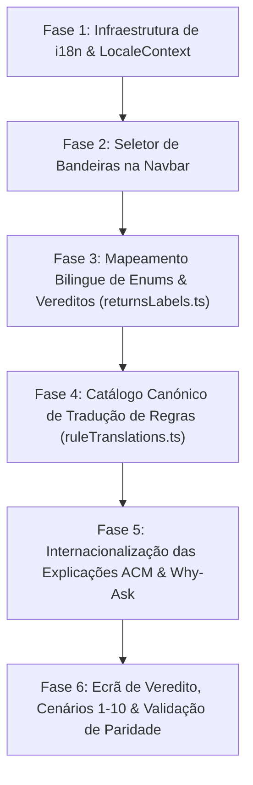

# Plano de Implementação: Internacionalização (i18n) do Dashboard e Tradução dos Motores de Inferência (Drools e Prolog)

**Documento:** Plano de Engenharia e Especificação Técnica de Implementação  
**Alvo:** Dashboard Next.js (`dashboard/`), Orquestrador FastAPI (`backend_orchestrator/`), Motores de Inferência (`drools-engine-levis-devolucoes-java` e `prolog_engine`)  
**Modelo Executor Designado:** Antigravity AI Agent (Gemini 3.8 Flash High)  
**Objetivo Primário:** Capacitar o sistema pericial para alternar dinamicamente entre **Português (pt-PT)** e **Inglês (en-US)** através de um seletor com bandeiras na barra de navegação superior (Navbar), traduzindo de forma transparente tanto a interface gráfica (GUI) como **as conclusões, explicações e justificações operacionais emitidas pelos motores de inferência declarativos (Drools e Prolog)**, permitindo que o perito avaliador de língua inglesa teste e audite integralmente o sistema.  

**Ficheiros Principais Envolvidos:**
- [`Navbar.tsx`](file:///c:/Users/santi/Desktop/meia-equipa3-challenge1-26_27/dashboard/src/components/ui/Navbar.tsx) — Inserção do seletor de bandeiras entre os links e o perfil.
- [`LocaleContext.tsx`](file:///c:/Users/santi/Desktop/meia-equipa3-challenge1-26_27/dashboard/src/contexts/LocaleContext.tsx) *(Novo)* — Provedor de contexto reativo e persistência de idioma.
- [`returnsLabels.ts`](file:///c:/Users/santi/Desktop/meia-equipa3-challenge1-26_27/dashboard/src/config/returnsLabels.ts) — Dicionários bilingues para enums, vereditos OUT-001 a OUT-008 e ações operacionais.
- [`ruleTranslations.ts`](file:///c:/Users/santi/Desktop/meia-equipa3-challenge1-26_27/dashboard/src/config/ruleTranslations.ts) *(Novo)* — Catálogo canónico de tradução de regras normativas (HS, PC, PT, CH, TN, EP, EX, CT, BW).
- [`ExplainTabs.tsx`](file:///c:/Users/santi/Desktop/meia-equipa3-challenge1-26_27/dashboard/src/components/returns/ExplainTabs.tsx) — Adaptação das 4 abas ACM (*Como*, *Porque Não*, *E Se*, *Validações*) e passagem do parâmetro `locale`.
- [`VerdictScreen.tsx`](file:///c:/Users/santi/Desktop/meia-equipa3-challenge1-26_27/dashboard/src/components/wizard/VerdictScreen.tsx) — Tradução do ecrã de veredito, cartões de saída e exportação de resumo.
- [`WhyAskWidget.tsx`](file:///c:/Users/santi/Desktop/meia-equipa3-challenge1-26_27/dashboard/src/components/wizard/WhyAskWidget.tsx) — Tradução das perguntas dialógicas e justificações causais durante o wizard.
- [`ReturnsPanel.tsx`](file:///c:/Users/santi/Desktop/meia-equipa3-challenge1-26_27/dashboard/src/components/engines/ReturnsPanel.tsx) & [`ScenarioPicker.tsx`](file:///c:/Users/santi/Desktop/meia-equipa3-challenge1-26_27/dashboard/src/components/returns/ScenarioPicker.tsx) — Tradução dos 10 cenários oficiais de teste.
- [`retail_prolog_service.py`](file:///c:/Users/santi/Desktop/meia-equipa3-challenge1-26_27/backend_orchestrator/app/services/retail_prolog_service.py) — Suporte ao parâmetro `locale` na orquestração de explicações Prolog.

---

## 1. Contexto Global e Análise Arquitetural

### 1.1. O Desafio do Sistema Dual e do Perito de Avaliação
O projeto implementa um sistema pericial dual de suporte à tomada de decisão para a política de trocas e devoluções da Levi Strauss & Co. (UC PPROGIA / MEIA Desafio 1). O sistema conta com:
1. **Motor Drools (Java / Spring Boot):** 98 regras declarativas compiladas em KJar, agrupadas nos módulos M0 a M9.
2. **Motor SWI-Prolog:** 71 regras declarativas distribuídas por 9 famílias operacionais (`HS`, `PC`, `PT`, `CH`, `TN`, `EP`, `EX`, `CT`, `BW`) com inferência dialógica orientada ao modelo do Prof. ACM.
3. **Orquestrador Python (FastAPI):** Normalização e garantia de paridade entre ambos os motores para as 8 conclusões canónicas (`OUT-001` a `OUT-008`).
4. **Dashboard Frontline POS (Next.js):** Interface de operador para execução de cenários, atendimento guiado (Wizard de 6 passos) e auditoria de explicabilidade em 5 vias.

O sistema necessita de ser testado e auditado por um **perito de domínio internacional que apenas comunica em inglês**. Enquanto traduzir a casca do dashboard (menus, botões, cabeçalhos) é trivial, **o núcleo crítico reside em traduzir os dados que emergem em tempo real dos motores de inferência**.

```
                           +-------------------------------------+
                           |      Dashboard Frontline POS        |
                           |     (Next.js App Router / BFF)      |
                           +------------------+------------------+
                                              |
                             [LocaleContext: 'pt' | 'en']
                                              |
                   +--------------------------+--------------------------+
                   |                                                     |
       +-----------v------------+                           +------------v-----------+
       |   Camada UI e Menus    |                           | Outputs dos Motores    |
       | - Navbar com bandeiras |                           | - Enums OUT-001 a 008  |
       | - Wizard de 6 passos   |                           | - Regras (HS, PC, ...) |
       | - Tabelas e botões     |                           | - Explicações Como/Porquê|
       +------------------------+                           | - Cenários 1 a 10      |
                                                            +------------+-----------+
                                                                         |
                                                   +---------------------+---------------------+
                                                   |                                           |
                                       +-----------v-----------+                   +-----------v-----------+
                                       |  Drools Engine (Java) |                   |  Prolog Engine (SWI)  |
                                       | - explicacoes_en.prop |                   | - regra_info / how    |
                                       | - DRL Mensagens em PT |                   | - justificações [RID] |
                                       +-----------+-----------+                   +-----------+-----------+
                                                   |                                           |
                                                   +---------------------+---------------------+
                                                                         |
                                                    +--------------------v--------------------+
                                                    |  Catálogo Canónico de Tradução          |
                                                    |  (Baseado no Código de Regra Canónico)  |
                                                    +-----------------------------------------+
```

---

### 1.2. Taxonomia das 4 Camadas de Dados Provenientes dos Motores

| Camada | Tipo de Dado Emitido pelo Motor | Exemplo em Português | Exemplo Traduzido para Inglês | Solução Técnica de Tradução |
| :--- | :--- | :--- | :--- | :--- |
| **Camada 1** | **Vereditos e Enums Canónicos** (`OUT-001` a `OUT-008`) | `PERMITIR`, `REVER`, `RECUSAR`, `AREA_VENDAS`, `VALOR_PAGO`, `POS`, `ORIGINAL` | *"Allowed / Approved"*, *"Manager Review"*, *"Denied"*, *"Sales Floor"*, *"Paid Value"*, *"POS"*, *"Original Tender"* | Mapeamento bilingue reativo em [`returnsLabels.ts`](file:///c:/Users/santi/Desktop/meia-equipa3-challenge1-26_27/dashboard/src/config/returnsLabels.ts) indexado por idioma. |
| **Camada 2** | **Justificações e Rastos de Regras** (`regras[].mensagem`, `regras[].nomeRegra`) | `[PC-002] Rever com gestão artigo não usado com etiquetas soltas; aprovar só se vendável.` | `[PC-002] Review with management: unused item with loose tags; approve only if resellable.` | **Catálogo Canónico de Regras por Código (`ruleCode`):** Como Drools e Prolog emitem exatamente os mesmos códigos normativos (`HS-xxx`, `PC-xxx`, etc.), as mensagens são mapeadas deterministicamente sem tocar nos ficheiros `.drl` ou `.pl` (preservando testes de paridade). |
| **Camada 3** | **Explicações das 5 Vias ACM** (*Como*, *Porque Não*, *E Se*, *Validações*) | *"Foram aplicadas 3 regras em 2 módulos"*, *"Condições não satisfeitas"*, *"Decisão terminal fixada por"* | *"3 rules were applied across 2 modules"*, *"Conditions not met"*, *"Terminal decision determined by"* | No Drools, envio de `locale=en` ativa o já existente [`explicacoes_en.properties`](file:///c:/Users/santi/Desktop/meia-equipa3-challenge1-26_27/drools-engine-levis-devolucoes-java/backend/pericial-explanation/src/main/resources/i18n/explicacoes_en.properties). No Prolog e UI, dicionário de causas e antecedentes (`CondicaoDto`). |
| **Camada 4** | **Cenários Oficiais e Perguntas Dialógicas** | Cenários 1 a 10 de Dustin Hopper; perguntas do Why-Ask (`IN-001` a `IN-010`) | *"Scenario 1: Mainline exchange with loose tags"*, *"01 / Territorial Jurisdiction"* | Tradução dos metadados de cenários em `cenariosExemplo` e dos cartões do [`WhyAskWidget.tsx`](file:///c:/Users/santi/Desktop/meia-equipa3-challenge1-26_27/dashboard/src/components/wizard/WhyAskWidget.tsx). |

---

## 2. Decisões Arquiteturais e Diretrizes de Design (ADR)

### ADR-01: Não Modificar as Strings Hardcoded dentro dos Ficheiros DRL e Prolog
* **Decisão:** Os ficheiros de regras declarativas (`.drl` no Drools e `.pl` no Prolog) permanecem inalterados no seu código fonte original.
* **Justificação:** Os testes unitários do Maven (`mvn test`) e os testes PLUnit do Prolog validam asserções de paridade contra os nós internos. Modificar strings cruas nos `.drl` implicaria recompilar o `.kjar`, invalidar ficheiros de migração e arriscar quebrar as suites de regressão do `test_parity_verdict.py`.
* **Implementação:** A tradução das mensagens de regras é feita na camada de orquestração / apresentação com base no `codigoRegra` (`ruleCode`), que é universal e imutável.

### ADR-02: Seletor de Idioma Integrado na Navbar
* **Decisão:** Inserir um seletor visual com bandeiras na [Navbar.tsx](file:///c:/Users/santi/Desktop/meia-equipa3-challenge1-26_27/dashboard/src/components/ui/Navbar.tsx) exatamente no espaço assinalado pelo utilizador (à direita de *"Decisões & Histórico"* e à esquerda do perfil de operador).
* **Especificação Estética:**
  * Segmented pill minimalista contendo os ícones das bandeiras: `[ 🇵🇹 PT | 🇬🇧 EN ]`.
  * O idioma ativo recebe realce visual discreto (`bg-slate-100 text-slate-900 shadow-2xs font-bold`), consistente com a identidade tipográfica Roundex / Plus Jakarta Sans do RetailFlow.
  * Acessibilidade completa com `role="group"`, `aria-label="Selecionar Idioma / Select Language"` e suporte de teclado.

### ADR-03: Persistência no LocalStorage e Propagação Reativa
* **Decisão:** O estado de idioma é gerido por um `LocaleContext` React.
* **Comportamento:** Ao alternar de idioma:
  1. A chave `retailflow_locale` é atualizada no `localStorage`.
  2. O atributo `lang` da tag `<html>` é atualizado (`pt-PT` ou `en-US`).
  3. Todos os componentes montados (Wizard, Ecrã de Veredito, Abas de Explicação, Painel de Histórico) re-renderizam instantaneamente com os rótulos e mensagens no novo idioma, sem necessidade de recarregar a página.

---

## 3. Fases Progressivas de Implementação



---

### Fase 1: Infraestrutura de Internacionalização e Estado Global (`LocaleContext`)

**Objetivo:** Criar o contexto global de idiomas que expõe o idioma ativo (`'pt' | 'en'`), funções de tradução utilitárias e sincronização com o armazenamento local.

#### Tarefas Detalhadas:
1. **Criar o ficheiro [`LocaleContext.tsx`](file:///c:/Users/santi/Desktop/meia-equipa3-challenge1-26_27/dashboard/src/contexts/LocaleContext.tsx):**
   * Tipagem estrita:
     ```typescript
     export type Locale = "pt" | "en";
     
     export interface LocaleContextType {
       locale: Locale;
       setLocale: (locale: Locale) => void;
       t: (key: string, fallback?: string) => string;
       isEn: boolean;
     }
     ```
   * Inicialização segura (SSR-friendly): ler de `localStorage` com fallback para `"pt"`.
   * Atualização dinâmica de `document.documentElement.lang`.
2. **Integrar o `LocaleProvider` no layout raiz:**
   * Atualizar [`dashboard/src/app/layout.tsx`](file:///c:/Users/santi/Desktop/meia-equipa3-challenge1-26_27/dashboard/src/app/layout.tsx) para envolver o corpo da aplicação com `<LocaleProvider>`.

---

### Fase 2: Componente do Seletor de Bandeiras na Navbar

**Objetivo:** Implementar o controlo interativo com bandeiras na barra de navegação no local exato assinalado a vermelho na captura de ecrã do utilizador.

#### Tarefas Detalhadas:
1. **Atualizar [`Navbar.tsx`](file:///c:/Users/santi/Desktop/meia-equipa3-challenge1-26_27/dashboard/src/components/ui/Navbar.tsx):**
   * Consumir o hook `useLocale()`.
   * Inserir o elemento antes do perfil do operador (linha 118):
     ```tsx
     {/* Seletor de Idioma (Bandeiras PT / EN) */}
     <div
       role="group"
       aria-label="Selecionar Idioma"
       className="flex items-center bg-slate-100/90 p-0.5 rounded-full border border-slate-200 text-xs font-sans select-none"
     >
       <button
         type="button"
         onClick={() => setLocale("pt")}
         className={`flex items-center gap-1 px-2.5 py-1 rounded-full font-medium transition-all ${
           locale === "pt"
             ? "bg-white text-slate-900 shadow-2xs font-bold"
             : "text-slate-500 hover:text-slate-900"
         }`}
         title="Português"
         aria-pressed={locale === "pt"}
       >
         <span className="text-sm">🇵🇹</span>
         <span className="hidden sm:inline">PT</span>
       </button>
       <button
         type="button"
         onClick={() => setLocale("en")}
         className={`flex items-center gap-1 px-2.5 py-1 rounded-full font-medium transition-all ${
           locale === "en"
             ? "bg-white text-slate-900 shadow-2xs font-bold"
             : "text-slate-500 hover:text-slate-900"
         }`}
         title="English"
         aria-pressed={locale === "en"}
       >
         <span className="text-sm">🇬🇧</span>
         <span className="hidden sm:inline">EN</span>
       </button>
     </div>
     ```
2. **Bilinguismo nos Links da Navbar e Perfil:**
   * Tradução dinâmica de `navLinks`:
     * `"Painel Principal"` $\leftrightarrow$ `"Main Dashboard"`
     * `"Novo Atendimento"` $\leftrightarrow$ `"New Assessment"`
     * `"Decisões & Histórico"` $\leftrightarrow$ `"Decisions & History"`
   * Tradução do cargo do operador:
     * `"Operador N2"` $\leftrightarrow$ `"Level 2 Operator"`
   * Seletor correspondente no menu móvel (*drawer*).

---

### Fase 3: Mapeamento Bilingue de Enums e Vereditos (`returnsLabels.ts`)

**Objetivo:** Tornar toda a biblioteca de rotulagem do sistema sensível ao idioma ativo (`pt` ou `en`).

#### Tarefas Detalhadas:
1. **Refatorar [`returnsLabels.ts`](file:///c:/Users/santi/Desktop/meia-equipa3-challenge1-26_27/dashboard/src/config/returnsLabels.ts):**
   * Expandir a assinatura das funções principais para aceitar `locale?: Locale`:
     * `label(value: unknown, locale?: Locale): string`
     * `moduleLabel(code?: string | null, locale?: Locale): string`
     * `cause(value: unknown, locale?: Locale): string`
     * `formatOperationalAction(processo, aprovacao, elegibilidade, locale?: Locale)`
     * `formatResolutionSubtext(tipo, meio, eleg, originalTender, locale?: Locale)`
     * `formatTenderSubtext(meio, eleg, originalTender, locale?: Locale)`
     * `formatDocumentationDetails(docs, locale?: Locale)`
2. **Definição de Dicionários em Inglês:**
   * **Elegibilidade (OUT-001):**
     * `PERMITIR`: `{ label: "Allowed / Approved", hint: "Request strictly complies with return policy." }`
     * `RECUSAR`: `{ label: "Denied / Rejected", hint: "Request does not meet commercial policy criteria." }`
     * `REVER`: `{ label: "Management Review", hint: "Requires managerial approval before settlement." }`
     * `ENCAMINHAR`: `{ label: "Escalate / Forward", hint: "Must be processed via specialized channel/workflow." }`
   * **Tipos de Transação (OUT-002):**
     * `DEVOLUCAO`: `"Return"`, `TROCA`: `"Exchange"`, `AJUSTE_PRECO`: `"Price Adjustment"`, `REEMBOLSO`: `"Monetary Refund"`, `TROCA_MESMO_ARTIGO`: `"Direct Size Exchange"`, `CREDITO_LOJA`: `"Store Credit"`.
   * **Base de Valor (OUT-003):**
     * `VALOR_PAGO`: `"Paid Value"`, `PRECO_ATUAL`: `"Current Selling Price"`, `VALOR_PROMOCIONAL`: `"Promotional Price"`, `VALOR_ESCALAO`: `"Tiered Discount Value"`, `PVP_ORIGINAL`: `"Original MSRP"`.
   * **Meios de Reembolso (OUT-004):**
     * `ORIGINAL`: `"Original Tender"`, `CARTAO_OFERTA`: `"Physical Gift Card"`, `CARTAO_OFERTA_ELETRONICO`: `"E-Gift Card"`, `DINHEIRO`: `"Cash"`, `MEIO_ALTERNATIVO`: `"Alternative Method"`, `APLICACAO_PAGAMENTO`: `"Payment App"`.
   * **Aprovação Necessária (OUT-005):**
     * `NENHUMA`: `"None (Standard Associate)"`, `GESTAO_LOJA` / `XSTORE_MANAGER`: `"Store Manager Override"`, `DISTRICT_MANAGER`: `"District Manager"`.
   * **Processos Obrigatórios (OUT-006):**
     * `POS`: `"Point of Sale (POS)"`, `BACKPOCKET`: `"BackPocket System"`, `AFTERPAY`: `"Afterpay Portal"`, `PAYPAL_VENMO`: `"PayPal / Venmo App"`, `VERIFONE_INTERAC`: `"Verifone Interac Terminal"`, `FRANQUIA_CANADA`: `"Canadian Franchise Workflow"`, `DANO`: `"Damaged Goods Logging"`, `RISCO_BIOLOGICO`: `"Biohazard Isolation"`.
   * **Destinos do Artigo (OUT-007):**
     * `AREA_VENDAS`: `"Return to Sales Floor"`, `SALDOS`: `"Markdown / Clearance"`, `REETIQUETAR`: `"Retagging Required"`, `BAIXA_DANO`: `"Damage Write-Off"`, `RISCO_BIOLOGICO`: `"Biohazard Disposal Bag"`, `DEVOLUCAO_CLIENTE`: `"Return to Customer"`.
   * **Documentação (OUT-008):**
     * Notas e assinaturas bilingues (`"Customer signature required"`, `"Staple receipt to register tape"`, `"Store Manager exception slip"`).
3. **Formatação Monetária Sensível ao Idioma:**
   * Atualizar `money(value, locale, currency)`:
     * `pt`: `129,99 €` ou `129,99 CAD $`
     * `en`: `$129.99` ou `CAD $129.99`

---

### Fase 4: Catálogo Canónico de Tradução de Regras (`ruleTranslations.ts`)

**Objetivo:** Criar a tabela universal de tradução para todos os 71 códigos normativos emitidos por Drools e Prolog, assegurando que o perito visualiza títulos e justificações em inglês retalhista natural.

#### Tarefas Detalhadas:
1. **Criar [`ruleTranslations.ts`](file:///c:/Users/santi/Desktop/meia-equipa3-challenge1-26_27/dashboard/src/config/ruleTranslations.ts):**
   * Estrutura de dados por código canónico:
     ```typescript
     export interface RuleTranslation {
       code: string;
       titlePt: string;
       titleEn: string;
       messagePt: string;
       messageEn: string;
     }
     ```
   * Cobertura de todas as 9 famílias de regras do sistema pericial:
     * **Hard Stops (`HS-001` a `HS-006`):**
       * `HS-001`: *"Reject item without recognized POS SKU"* $\rightarrow$ *"Recusar produto sem SKU reconhecido no POS"*
       * `HS-002`: *"Reject non-qualifying brand (Dockers/Signature/Beyond Yoga)"* $\rightarrow$ *"Recusar marcas excluídas"*
       * `HS-003`: *"Reject tailored, hemmed, or customized garments"* $\rightarrow$ *"Recusar produtos personalizados ou embainhados"*
       * `HS-004`: *"Escalate to Canada Franchise procedure without generic SKU"* $\rightarrow$ *"Encaminhar para processo de franquia do Canadá"*
       * `HS-005`: *"Reject tender exception for online Afterpay returns"* $\rightarrow$ *"Recusar exceção de reembolso para Afterpay online"*
       * `HS-006`: *"Escalate transaction: associate lacks authorized POS credentials"* $\rightarrow$ *"Encaminhar: colaborador sem autorização"*
     * **Product Condition (`PC-001` a `PC-008`):**
       * `PC-001`: *"Allow return eligibility: pristine unworn item with intact original tags"*
       * `PC-002`: *"Manager review: unworn item with detached tags; approve only if resellable"*
       * `PC-003`: *"Manager review: unworn item without tags; approve only if prep-ready"*
       * `PC-004`: *"Manager review: non-defective worn garment; authorize same-item exchange only"*
       * `PC-005`: *"Reject washed garment without verified manufacturing defect"*
       * `PC-006`: *"Allow refund or direct replacement with damage write-off for manufacturing defect"*
       * `PC-007`: *"Allow bodywear return under 100% satisfaction guarantee"*
       * `PC-008`: *"Reject and quarantine soiled, contaminated, or hazardous garment in biohazard bag"*
     * **Proof & Timeframe (`PT-001` a `PT-008`):**
       * `PT-001`: *"Classify as verified return with valid proof of purchase"*
       * `PT-002`: *"Classify as blind return due to absence of verifiable proof of purchase"*
       * `PT-003`: *"Allow full refund to original tender or exchange for verified return within 30 days"*
       * `PT-004`: *"Manager review: verified return beyond 30 days; store credit at discretion"*
       * `PT-005`: *"Permit exclusively store credit or exchange at current selling price for blind return"*
       * `PT-006`: *"Skip identification requirement if customer refuses data or language barrier persists"*
       * `PT-007`: *"Allow one-time price adjustment in POS within 14 days with original receipt"*
       * `PT-008`: *"Reject price adjustment after 14 days or without original physical receipt"*
     * **Channels (`CH-001` a `CH-010`):**
       * `CH-001`: *"Apply receiving store format policies for Mainline and Outlet locations"*
       * `CH-002`: *"Forward verified online purchase through BackPocket system for original tender refund"*
       * `CH-003`: *"Online purchase without matching order handled as blind return with gift card"*
       * `CH-004`: *"Manager review when online returns portal is unavailable or offline"*
       * `CH-005`: *"Issue physical gift card for online returns shipped more than 30 days ago"*
       * `CH-006`: *"Complete online exchange and refund remaining balance to original tender"*
       * `CH-007`: *"Forward Canadian franchise garment using franchise SKU workflow"*
       * `CH-008`: *"Reject wholesale garment and refer customer back to original retail seller"*
       * `CH-009`: *"Calculate blind return in Outlet store based on current price with active promotions"*
       * `CH-010`: *"Return Mainline purchase in Outlet store at original paid price when permitted"*
     * **Tender & Payment (`TN-001` a `TN-012`):**
       * `TN-001`: *"Automatic tokenized credit/debit card refund: physical card presentation not required"*
       * `TN-002`: *"Automatic account refund for lost, stolen, or expired replacement bank card"*
       * `TN-003`: *"Allow alternative refund tender if bank account is closed and chargeback declined"*
       * `TN-004`: *"Strictly prohibit cash refund for card purchases without prior POS bank decline"*
       * `TN-005`: *"Automatic tokenized refund for contactless (Apple Pay / Google Pay) purchase"*
       * `TN-006`: *"Refund remaining transaction balance to original payment tender during exchange"*
       * `TN-007`: *"Gift return resolution: issue store credit to presenter or original cardholder refund"*
       * `TN-008`: *"Require customer in-app barcode scan for PayPal or Venmo store returns"*
       * `TN-009`: *"Process store-bought Afterpay return via associate Afterpay terminal app"*
       * `TN-010`: *"Process online Afterpay return strictly through BackPocket system"*
       * `TN-011`: *"Mandatory physical Canadian Interac debit card presentation for in-store refund"*
       * `TN-012`: *"Process Interac BackPocket return with manual terminal debit reversal"*
     * **Exchanges & Prices (`EP-001` a `EP-006`):**
       * `EP-001`: *"Even size exchange for identical style and color preserving original promotional value"*
       * `EP-002`: *"Different style or color exchange processed as return and new sale at current price"*
     * **Manager Overrides (`EX-001` a `EX-008`):**
       * `EX-001`: *"Store Manager or Key Holder discretion evaluates counter exception request"*
       * `EX-002`: *"Explain policy firmly and present allowed alternative upon customer dispute"*
       * `EX-003`: *"Escalate to senior store manager when customer displays hostile or agitated behavior"*
       * `EX-004`: *"Authorize counter exception only when hard stops are absent and system permits"*
       * `EX-005`: *"Apply least permissive resolution when granting commercial policy exception"*
       * `EX-006`: *"Strictly refuse exception that overrides Afterpay policy or unauthorized brands"*
       * `EX-007`: *"Document business justification formally on manager exception log"*
       * `EX-008`: *"Immediately suspend return and notify store security upon fraud indicators"*
     * **Controls & Context (`CT-001` a `CT-005`):**
       * `CT-001`: *"Verified return processed by associate with authenticated POS credentials"*
       * `CT-002`: *"Blind return requires biometric/credential approval from Store Manager"*
       * `CT-003`: *"Same associate completes transaction from start to finish with private credentials"*
     * **Bodywear (`BW-001` a `BW-003`):**
       * `BW-001`: *"Return intact, unopened bodywear package directly to sales floor"*
       * `BW-002`: *"Quarantine and dispose of opened, broken-seal, or worn bodywear"*
2. **Função Utilitária de Tradução `translateRuleOutput(code, rawTitle, rawMessage, locale)`:**
   * Extrai o código da regra (ex.: `PC-002`).
   * Se `locale === 'en'`, recupera a entrada do catálogo. Se a regra existir no catálogo, substitui a mensagem e título pelo texto em inglês.
   * Se o código for desconhecido ou não catalogado, aplica `cleanRuleCodes` e mantém fallback seguro.

---

### Fase 5: Internacionalização das Explicações ACM e Why-Ask

**Objetivo:** Adaptar os módulos de explicabilidade das 5 vias para reagirem ao idioma selecionado.

#### Tarefas Detalhadas:
1. **Atualizar [`ExplainTabs.tsx`](file:///c:/Users/santi/Desktop/meia-equipa3-challenge1-26_27/dashboard/src/components/returns/ExplainTabs.tsx):**
   * Consumir `useLocale()`.
   * Dinamizar a chamada à API:
     ```typescript
     const apiLocale = locale === "en" ? "locale=en" : "locale=pt-PT";
     api<ExplicacaoComoResponse>(`${base}/avaliacoes/${evaluationId}/explicacoes/como?${apiLocale}`);
     ```
   * Traduzir as 4 abas ACM:
     * `"Como Decidiu?"` $\leftrightarrow$ `"How It Decided"`
     * `"Porque Não...?"` $\leftrightarrow$ `"Why Not..."`
     * `"Simulação E Se..."` $\leftrightarrow$ `"What-If Simulation"`
     * `"Factos e Validações"` $\leftrightarrow$ `"Facts & Validations"`
   * Traduzir os banners e resumos:
     * `"Cadeia Dedutiva Concluída:"` $\leftrightarrow$ `"Deductive Chain Completed:"`
     * `"Resumo do Raciocínio Normativo:"` $\leftrightarrow$ `"Normative Reasoning Summary:"`
     * `"Decisão estabelecida pela Regra"` $\leftrightarrow$ `"Decision determined by Rule"`
   * Traduzir as premissas contrafactuais na aba *Porque Não*:
     * Tradução de `item.nome` e `item.descricao` (ex.: `colaboradorAutorizado` $\rightarrow$ *"Authorized associate"*, `diasDesdeCompra <= 30` $\rightarrow$ *"Days since purchase <= 30"*).
     * Valores apurados: `true` $\rightarrow$ `"Yes"`, `false` $\rightarrow$ `"No"`.
   * Traduzir os presets de simulação *E Se*:
     * `"As etiquetas estivessem colocadas"` $\leftrightarrow$ `"If tags were attached"`
     * `"O portal online estivesse disponível"` $\leftrightarrow$ `"If online portal were operational"`
     * `"O artigo estivesse claramente usado"` $\leftrightarrow$ `"If item were clearly used"`
2. **Atualizar [`WhyAskWidget.tsx`](file:///c:/Users/santi/Desktop/meia-equipa3-challenge1-26_27/dashboard/src/components/wizard/WhyAskWidget.tsx):**
   * Traduzir os cartões de metaconhecimento do Professor ACM:
     * `"Porquê da Pergunta?"` $\leftrightarrow$ `"Why Ask This Question?"`
     * `"Fundamento Normativo:"` $\leftrightarrow$ `"Normative Policy Basis:"`
     * `"Regras em Espera:"` $\leftrightarrow$ `"Candidate Waiting Rules:"`
     * Tradução das áreas de política (`POLICY_NAMES`) e dos desfechos (`OUTCOME_DEFINITIONS`).
3. **Atualizar [`stepInputMapping.ts`](file:///c:/Users/santi/Desktop/meia-equipa3-challenge1-26_27/dashboard/src/config/stepInputMapping.ts):**
   * Adicionar rótulos bilingues para os atributos de entrada (`IN-001` a `IN-010`):
     * `IN-001`: `"01 / Territorial Jurisdiction"` / `"01 / Jurisdição Territorial"`
     * `IN-002`: `"02 / Store Commercial Format"` / `"02 / Formato Comercial da Loja"`
     * `IN-003`: `"03 / Original Purchase Channel"` / `"03 / Canal de Compra Original"`
     * `IN-004`: `"02 / Proof of Purchase Presented"` / `"02 / Comprovativo Apresentado"`
     * `IN-005`: `"01 / Customer Request Type"` / `"01 / Tipo de Pedido Formulado"`
     * `IN-006`: `"03 / Elapsed Days Since Purchase"` / `"03 / Prazo Decorrido da Compra"`
     * `IN-007`: `"01 / Product Identification & Brand"` / `"01 / Identificação & Marca"`
     * `IN-008`: `"02 / Item Physical Condition"` / `"02 / Estado Físico do Artigo"`
     * `IN-009`: `"02 / Original Payment Tender"` / `"02 / Meio de Pagamento Original"`
     * `IN-010`: `"03 / Resale Feasibility"` / `"03 / Possibilidade de Revenda"`

---

### Fase 6: Ecrã de Veredito, Cenários Oficiais e Validação de Paridade

**Objetivo:** Ajustar o ecrã final de veredito, os 10 cenários de referência e executar a bateria completa de testes de regressão.

#### Tarefas Detalhadas:
1. **Atualizar [`VerdictScreen.tsx`](file:///c:/Users/santi/Desktop/meia-equipa3-challenge1-26_27/dashboard/src/components/wizard/VerdictScreen.tsx):**
   * Consumir `useLocale()`.
   * Integrar a tradução nas 8 caixas canónicas (`OUT-001` a `OUT-008`).
   * Traduzir as ações operacionais imediatas do balcão (`formatOperationalAction`).
   * Traduzir a função `getHumanExplanation()`:
     * Para inglês, aplicar `translateRuleOutput` na regra substantiva vencedora.
     * Fallbacks bilingues elegantes:
       * `PERMITIR`: *"Return approved. The item meets all physical condition requirements, valid proof of purchase, and the allowed timeframe."*
       * `RECUSAR`: *"Return denied. The request does not comply with commercial policy criteria for the channel and condition presented."*
       * `REVER`: *"Manager review required. Counter exception requires store manager authorization before tender refund."*
       * `ENCAMINHAR`: *"Forward request. Transaction requires processing via dedicated workflow or application."*
   * Traduzir a funcionalidade de cópia de resumo (`handleCopySummary`):
     * Gerar o relatório textual de atendimento em inglês quando `locale === 'en'`.
2. **Atualizar Cenários Oficiais 1 a 10 em [`ScenarioPicker.tsx`](file:///c:/Users/santi/Desktop/meia-equipa3-challenge1-26_27/dashboard/src/components/returns/ScenarioPicker.tsx) e [`ReturnsPanel.tsx`](file:///c:/Users/santi/Desktop/meia-equipa3-challenge1-26_27/dashboard/src/components/engines/ReturnsPanel.tsx):**
   * Títulos em inglês dos 10 cenários compilados por Dustin Hopper:
     * **Cenário 1:** *"Mainline Store Size Exchange with Loose Tags within 29 Days"*
     * **Cenário 2:** *"Online Afterpay Purchase Requesting Store Exchange Exception with Escalation"*
     * **Cenário 3:** *"Outlet Blind Gift Return without Proof of Purchase"*
     * **Cenário 4:** *"Manufacturing Defect on Altered / Hemmed Jeans within 10 Days"*
     * **Cenário 5:** *"Wholesale Brand Garment (Signature) Return Refusal"*
     * **Cenário 6:** *"Biohazard / Soiled Garment Immediate Counter Refusal with Quarantine"*
     * **Cenário 7:** *"Canadian Store Interac Debit Return without Physical Card Present"*
     * **Cenário 8:** *"Price Adjustment Request at 13 Days with Receipt Photograph"*
     * **Cenário 9:** *"Outlet Bodywear Package Disposition under Hygiene Policy"*
     * **Cenário 10:** *"Online PayPal Return during Returns Portal Outage"*
3. **Execução da Suite de Testes de Paridade:**
   * Executar [`test_parity_verdict.py`](file:///c:/Users/santi/Desktop/meia-equipa3-challenge1-26_27/test_parity_verdict.py).
   * Validar que nenhuma alteração nos modelos de dados ou contratos de resposta quebra as asserções de paridade entre Drools e Prolog.

---

## 4. Matriz de Rastreabilidade e Arquivos Modificados

| Componente | Ficheiro | Tipo de Modificação | Risco |
| :--- | :--- | :--- | :--- |
| **Contexto i18n** | `dashboard/src/contexts/LocaleContext.tsx` | Criação de novo módulo | Mínimo (Isolado) |
| **Layout Global** | `dashboard/src/app/layout.tsx` | Adição de `<LocaleProvider>` | Mínimo |
| **Navegação** | `dashboard/src/components/ui/Navbar.tsx` | Adição do seletor `[ 🇵🇹 PT \| 🇬🇧 EN ]` | Mínimo |
| **Rótulos & Enums** | `dashboard/src/config/returnsLabels.ts` | Adição de dicionários e parâmetro `locale` | Baixo (Backward compatible) |
| **Catálogo de Regras**| `dashboard/src/config/ruleTranslations.ts` | Criação de catálogo bilingue para 71+ regras | Mínimo (Aditivo) |
| **Explicações ACM** | `dashboard/src/components/returns/ExplainTabs.tsx` | Dinamização de `locale` e tradução de abas | Baixo |
| **Veredito do Balcão**| `dashboard/src/components/wizard/VerdictScreen.tsx`| Consumo do catálogo bilingue e copy summary | Baixo |
| **Why-Ask ACM** | `dashboard/src/components/wizard/WhyAskWidget.tsx` | Tradução de metaconhecimento e perguntas | Baixo |
| **Cenários de Teste** | `dashboard/src/components/returns/ScenarioPicker.tsx`| Títulos dos 10 cenários oficiais em inglês | Mínimo |

---

## 5. Critérios de Aceitação e Checklist de Verificação

### Checklist de Qualidade da Implementação:
- [ ] O seletor de bandeiras está posicionado na [Navbar.tsx](file:///c:/Users/santi/Desktop/meia-equipa3-challenge1-26_27/dashboard/src/components/ui/Navbar.tsx) exatamente entre os links de navegação e o perfil do operador.
- [ ] Ao clicar em 🇬🇧 EN, a interface altera imediatamente todos os cabeçalhos, títulos de passos do Wizard e rótulos da Navbar.
- [ ] Ao avaliar qualquer cenário no Drools ou no Prolog com 🇬🇧 EN selecionado:
  - [ ] A elegibilidade `OUT-001` aparece como *"Allowed / Approved"*, *"Denied"*, *"Manager Review"*, ou *"Escalate"*.
  - [ ] O tipo de transação `OUT-002` aparece como *"Refund"*, *"Exchange"*, *"Store Credit"*, etc.
  - [ ] A justificação substantiva da decisão (regra vencedora) surge em inglês formal retalhista, sem termos técnicos truncados ou preposições órfãs.
  - [ ] O rasto cronológico de regras da aba *Como Decidiu?* lista as regras disparadas com títulos e mensagens em inglês.
  - [ ] A aba *Porque Não...?* apresenta as regras candidatas com causas em inglês (*"Rule fired"*, *"Conditions not met"*) e premissas booleanas claras (*Yes / No*).
  - [ ] O widget *Porquê da Pergunta?* contextualiza a justificação normativa da política em inglês.
  - [ ] O botão "Copiar Resumo" copia o relatório de atendimento integralmente formatado em inglês.
- [ ] A escolha de idioma persiste após recarregar o browser (`localStorage`).
- [ ] A suite `test_parity_verdict.py` executa e passa a 100%, comprovando paridade total e zero quebras na API de backend.
